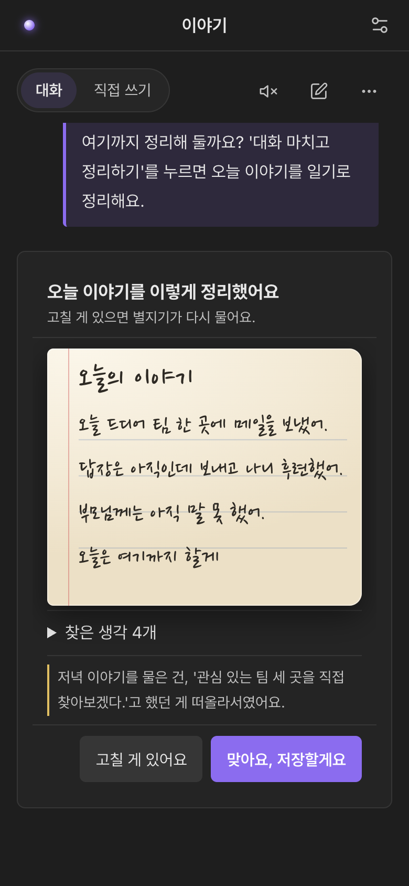
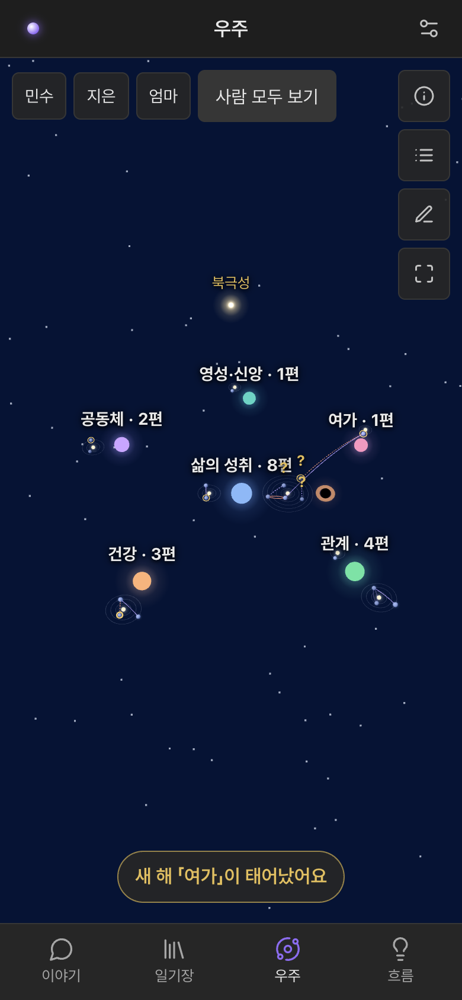
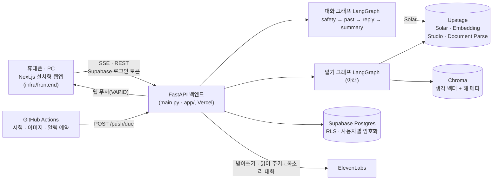

# 🌌 나의 우주

일기에서 **생각이 바뀐 순간을 내 말 그대로** 찾아 주고, **되고 싶은 모습에서 멀어지면 먼저 묻는** 일기장입니다.

AI(별지기)와 이야기하듯 답하면 AI가 일기 한 편으로 정리하고, **내가 확인한 뒤에만** 저장합니다. 쌓인 일기는 커리어 · 인간관계 두 '해' 둘레의 '작은 별'(같은 고민 묶음)로 우주처럼 보이고, 내 생각이 언제 어떻게 바뀌었는지를 **원문 인용과 날짜**로 보여 줍니다.

전남대 × 업스테이지 Agent Ops 프로그램 5조 · 최종판 v9 (2026-11-07 발표)

| | 주소 |
| --- | --- |
| 데모(설치형 웹앱, 휴대폰은 홈 화면에 추가) | https://my-universe-seven.vercel.app |
| 백엔드 상태 | https://my-universe-api.vercel.app/health |
| 저장소 | https://github.com/Lumiere001/my-universe |

| 되고 싶은 모습 인터뷰(일기 3편 뒤) | 이야기: 별지기와 대화 | 마치면: 정리본 확인 | 우주 |
| --- | --- | --- | --- |
|  |  |  |  |

---

## 1. 서비스 소개

**누가:** 하루를 돌아보고 싶지만 일기를 쓰다 마는 20대(파일럿은 커리어 고민이 있는 20대).

**문제:** 빈 일기장 앞에서 무엇을 쓸지 막막하다. 써도 쌓인 글로 지금의 나를 이해하지 못한다. 생각이 어떻게 바뀌었는지 알려면 지난 글을 직접 찾아 대조해야 한다.

**나의 우주가 하는 일**

| | 기능 | 어떻게 |
| --- | --- | --- |
| 1 | **되고 싶은 모습 정하기** | 처음 오면 바로 일기(이야기)부터 쓰고, 일기 3편을 저장하면 다섯 질문 인터뷰를 권한다(방향 · 이유 · 장면 · 안쪽 걸림 · 그때, 설정 · 우주에서 언제든). '~하지 않는 사람'처럼 피하는 말로 답하면 이유와 예시를 들어 한 번 더 묻는다 |
| 2 | **별지기와 대화** | 앱을 열면 별지기가 가볍게 오늘 하루를 묻고, 지난 일기에 아직 답이 안 난 고민은 대화가 그 이야기에 닿을 때 한 번 꺼낸다. 고른 시각에 알림으로도 부른다 |
| 3 | **말하듯 기록 → 내가 확인** | 글 · 말(받아쓰기) · 목소리 대화 · 손글씨 사진 · 지난 일기 파일. 대화를 마치면 말버릇 · 되풀이를 뺀 다듬은 일기(생각이 드러난 문장은 내 말 그대로)를 한 화면에서 보고 '고칠 게 있어요'로 고친 뒤 저장. 원문(대화 대본)도 남는다 |
| 4 | **내 우주와 알게 된 것** | 생각 하나하나를 해(커리어 · 인간관계) → 작은 별(같은 고민) → 행성(기록)으로 놓고, 이어 온 · 바뀐 · 맞서는 · 정리된 생각을 원문 인용으로. 실선은 글에 직접 쓴 것, 점선은 AI 추정 |
| 5 | **멀어지면 방향 던지기** | 일기 속 걸림이 되고 싶은 모습과 멀어지는 쪽으로 반복되면 대화 안에서 "어디로 가 볼까요" |
| 6 | **사람마다 맞춰지는 운영** | 맞아요 · 아니에요 · 별로 반응이 쌓이면 그 사람 설정만 한 칸 자동 조정(알림 · 되돌리기). 운영자는 사람 이름 없이 분포만 본다 |

**지키는 원칙:** 일기 원문 · 사람 이름은 사용자별 키로 암호화(운영자도 못 읽음), 외부 AI에는 이름을 가명으로, 로그 · 통계에는 원문 없음. 위기 신호는 규칙 + Solar 두 단계로 살펴 암호문 안에 남기고, 평소 결과에 위로 한마디와 안부 한 줄을 준다(상담 기관 안내는 정식 운영 때 정함).

---

## 2. 아키텍처



**일기 한 편의 길** (`app/agents/graph.py`, 노드마다 암호화 체크포인트 → 끊기면 끝난 단계를 건너뛰고 이어 하기)

```
safety → names → record_input → record_agent → record_clean → ontology → group_stars
       → past → observe → rules → voice → (대화 정리본이면 사용자 확인까지 멈춤) → save
```

| 단계 | 하는 일 | 쓰는 것 |
| --- | --- | --- |
| safety · names | 위기 신호(규칙 + Solar), 사람 이름 가명 | Solar |
| record_agent | **Studio 기록 Agent**: Parse → Classify(글 유형) → Extract(생각 · 종류 · 확신 · 가치 · 원문 인용) | Upstage Studio |
| record_clean | 관문: 원문에 없는 인용 · 날짜 · 단정 표현 · 실명 거르기 | 코드 |
| ontology · group_stars | 생각 → 해(커리어 · 인간관계) → 작은 별, Solar가 쌓인 작은 별을 같은 고민끼리 묶기 | Solar Embedding · Solar · Chroma |
| past · observe · rules | 지난 생각 고르기(Chroma `where` 해 필터) → **Studio 관측 Agent**(Parse → Classify 관측 상태 → Extract 관계) → 시간 · 감정 규칙과 실선/점선 규칙 | Chroma · Upstage Studio |
| voice · save | 근거 있는 한마디, 저장 · 정리가 끝나면 알림 | Solar · Supabase |

| 부분 | 기술 | 위치 |
| --- | --- | --- |
| 화면 | Next.js 16 · React 19 · Three.js, 설치형 웹앱(서비스 워커 · 웹 푸시) | `infra/frontend/` |
| 백엔드 | FastAPI · LangGraph, SSE 스트림 | `main.py`, `app/api` · `app/agents` · `app/service` |
| 온톨로지 | 해 · 작은 별 · 생각 종류 · 관계(닫힌 목록 + 열린 이름) | `app/core/ontology/v8.json` |
| DB · 로그인 | Supabase(구글 · 메일 코드 로그인, RLS, AES-GCM 사용자별 키) | `supabase/migrations/` |
| 벡터 | Chroma(로컬 · Docker는 컨테이너, 배포는 Chroma Cloud) | `app/agents/tools.py` |
| Studio 설정 | 기록 Agent · 관측 Agent 내보낸 원본 | `agent_configs/` |
| 평가 | 골든셋 · 가상 인물 A~F × 일기 20편(정답 심음) · 흔들림 | `eval/`, `tools/persona_eval.py` |
| 배포 | Vercel 두 프로젝트(백엔드 = 저장소 루트, 화면 = `infra/frontend`), GHCR 이미지 | `vercel.json`, `.github/workflows/` |

더 자세한 설명: [쉬운 기술 설명](docs/tech-explainer-v8.md) · [보안 검토](docs/security-review-v8.md) · [요청 추적](docs/trace.md) · [평가](docs/eval-v8.md).

---

## 3. 실행 방법

### Docker (3개: ChromaDB · 백엔드 · 화면)

```bash
cp .env.example .env              # UPSTAGE_API_KEY · Studio Agent ID · DIARY_ENC_KEY 등(값은 .env 에만)
supabase start                    # 로그인 · DB(로컬 Supabase). 처음이면 scripts/dev_up.sh 가 시험용 계정 · 데모 우주까지
scripts/start_docker.sh           # ChromaDB 8000 · 백엔드 8001 · 화면 8002 → http://localhost:8002
scripts/stop_docker.sh            # 끄기(데이터는 볼륨에 남김)
```

- 포트를 바꾸려면 `CHROMA_HOST_PORT=18000 BACKEND_HOST_PORT=18001 FRONTEND_HOST_PORT=18002 scripts/start_docker.sh`.
- 빌드 없이 받기: `docker compose -f docker-compose.yml -f docker-compose.ghcr.yml pull && … up -d`(GHCR 이미지 `ghcr.io/lumiere001/my-universe-{backend,frontend,chroma}`, master 에 push 하면 Actions 가 만듦).
- 2026-11-04 v9 확인: 이미지 세 개 빌드 → `GET /health` ok · `GET /health?deep=1` DB · 벡터 ok · 화면 200 · 토큰 없이 `/me` 401 · ChromaDB heartbeat. 기록: [docs/docker-verify.md](docs/docker-verify.md).

### 로컬 개발

```bash
uv sync
scripts/dev_up.sh                 # 처음 한 번(Docker 켜 둔 채): 로컬 Supabase · ChromaDB · .env.local · 시험용 계정
scripts/start.sh                  # 백엔드 8001 + 화면 3000 → http://localhost:3000
cd infra/frontend && NEXT_PUBLIC_MOCK=1 npm run dev   # 서버 없이 가짜 데이터 화면
```

### 시험

```bash
uv run --frozen pytest -q                              # 825개(로컬 Supabase 가 꺼져 있으면 DB 통합 시험은 건너뜀)
uv run --frozen python eval/run.py --check             # 골든셋 관문 · 기준선 회귀(외부 호출 없음)
cd infra/frontend && npx playwright test               # 휴대폰 화면 e2e(가짜 데이터, 캡처를 docs/images 에 다시 씀)
uv run --frozen python tools/persona_eval.py run …     # 가상 인물 서비스 길 평가(유료, 글 한 편 약 $0.10)
```

push · PR 마다 GitHub Actions `test` 가 키 없이 pytest 와 골든셋 검사를 돌린다. 유료 실행은 `runs/cost_ledger.jsonl` 에 한 줄씩 남긴다.

---

## 4. 환경변수

전체 목록과 설명은 [`.env.example`](.env.example)(백엔드) · [`infra/frontend/.env.example`](infra/frontend/.env.example)(화면). 값(키)은 저장소에 넣지 않는다.

| 묶음 | 이름 | 꼭 필요 |
| --- | --- | --- |
| Upstage | `UPSTAGE_API_KEY`, `RECORD_AGENT_ID` · `OBSERVE_AGENT_ID`, `V8_RECORD_CONFIG_ID` · `V8_OBSERVE_CONFIG_ID`(운영 5 · 4) | ✓ |
| Supabase | `SUPABASE_URL` · `SUPABASE_ANON_KEY` · `DATABASE_URL`, `SUPABASE_SERVICE_ROLE_KEY`(계정 지우기만) | ✓ |
| 암호화 | `DIARY_ENC_KEY`(base64 32바이트, 잃으면 일기를 못 연다) | ✓ |
| Chroma | `CHROMA_HOST` · `CHROMA_PORT`(로컬 · Docker) 또는 `CHROMA_API_KEY` · `CHROMA_TENANT` · `CHROMA_DATABASE`(Cloud) | ✓ |
| 화면 주소 | `FRONTEND_ORIGIN`(CORS) | ✓ |
| 온톨로지 | `ONTOLOGY_PROFILE=two`(커리어 · 인간관계), `STAR_GROUPS`, `SUN_GROW_AT` | |
| 목소리 | `ELEVENLABS_API_KEY`, `ELEVENLABS_AGENT_ID` · `VOICE_LLM_KEY`, `VOICE_CALL_ON=1`(목소리 대화, 기본 꺼짐) | |
| 개인 맞춤 | `TASTE_LOOP`(취향 고리, 기본 켬 — `0` 이면 끔) | |
| 알림 | `VAPID_PUBLIC_KEY` · `VAPID_PRIVATE_KEY` · `VAPID_SUBJECT`, `CRON_SECRET` | |
| 운영 | `ADMIN_EMAILS`(운영 화면), `DAILY_ENTRY_LIMIT` · `MONTHLY_COST_CAP_USD`(비우면 상한 없음), `DRAFT_KEEP_HOURS`(확인 전 초안 보관, 72) | |
| 추적 | `OTEL_EXPORTER_OTLP_ENDPOINT`(로컬 Phoenix만, 원문 없는 span) | |
| 화면 | `NEXT_PUBLIC_API_BASE` · `NEXT_PUBLIC_SUPABASE_URL` · `NEXT_PUBLIC_SUPABASE_ANON_KEY` · `NEXT_PUBLIC_SITE_URL` · `NEXT_PUBLIC_CONTACT_EMAIL`, `NEXT_PUBLIC_MOCK=1`(가짜 데이터) | ✓(MOCK 아니면) |

---

## 5. API

모든 요청은 Supabase 로그인 토큰(`Authorization: Bearer …`)이 필요하고, 동의 전에는 기록을 만들 수 없다(403 `consent_required`). 자세한 모양: [docs/api-v8.md](docs/api-v8.md). 로컬은 `API_DOCS=1` 이면 `http://localhost:8001/docs`.

| 묶음 | 주요 엔드포인트 |
| --- | --- |
| 이야기(대화) | `POST /talk` · `GET /talk` · `GET /talk/{cid}` · `POST /talk/{cid}/turn/stream`(SSE) · `POST /talk/{cid}/finish/stream`(정리본 만들기) · `POST /talk/{cid}/fix`(고칠 게 있어요) · `DELETE /talk/{cid}` |
| 일기 | `POST /diary/stream`(SSE, 일기 그래프) · `GET /diary` · `GET /diary/{id}` · `POST /diary/{id}/confirm` · `POST /diary/{id}/resume/stream` · `POST`/`DELETE /diary/{id}/notify`(끝나면 알림) · `DELETE /diary/{id}` |
| 입력 | `POST /photo/read`(손글씨 사진, Document Parse) · `POST /import/instagram/preview` · `POST /voice/transcribe` · `POST /voice/speak` · `POST /voice/call`(목소리 대화 토큰) |
| 우주 · 알게 된 것 · 흐름 | `GET /universe` · `GET /insight` · `GET /insight/brief` · `POST /insight/ask` · `GET`/`POST`/`PATCH /suns` · `PATCH /stars/{sid}` · `POST /stars/{sid}/detach` · `GET`/`POST /stars/merge` · `PATCH /thoughts/{tid}` · `GET`/`PATCH`/`DELETE /people…` |
| 되고 싶은 모습 | `GET`/`POST /aspiration` · `POST /aspiration/values` · `POST /aspiration/decline` |
| 계정 · 설정 | `GET`/`DELETE /me` · `GET`/`POST /consent` · `PATCH /settings` · `GET /settings/suggestions` · `POST /feedback` · `GET /export` |
| 알림 | `GET /push/key` · `POST`/`GET`/`DELETE /push/subscribe` · `POST /push/due`(예약 작업, `CRON_SECRET`) |
| 운영 | `GET /ops/summary` · `GET /ops/feedback` · `POST /ops/feedback/summarize`(`ADMIN_EMAILS` 계정만, 숫자 · 코드만) |
| 상태 | `GET /health` · `GET /health?deep=1`(DB · 벡터) · `GET /ontology` |

---

## 6. 평가와 운영

| 무엇 | 결과 |
| --- | --- |
| 가상 인물 6명 × 일기 20편, 서비스와 같은 길(10/31) | 해 맞힘 **90%**, 같은 주제 F1 **0.73**, 심어 둔 연결 **40/58**, 글 한 편 약 96초 · $0.10 |
| 알려진 한계 | 같은 글을 3번 정리하면 묶음이 모두 같은 경우 0/24(겹침 0.46). 글 하나에 묶음이 바뀌는 비율 13% |
| 실제 사용자(11/3~11/7) | 가입 17명 → 한마디라도 말함 4명 → 일기 저장 3명. 첫 대화 화면 이탈을 보고 11/5 일기 먼저 시작으로 바꿈(그 뒤 3명 중 2명이 말하고 저장). 받은 불편은 다음 날 고쳐 운영에 반영(되고 싶은 모습 다시 묻기 · 정리가 끝나면 알림) |
| 프롬프트 인젝션(11/7) | 로컬에서 일기 3 · 대화 3가지(지시 따르기 · 지시문 빼내기 · 없는 인용 · 역할 바꾸기 · 위기 검사 끄기)를 넣어 6/6 막음. 한 번씩 돌린 작은 시험 |
| 개인 맞춤 취향 고리(11/7) | 기준은 둘: 지금 듣기 좋았나(좋아요 · 별로)와 그 한마디를 들은 뒤 쓴 다음 글이 되고 싶은 모습에 다가갔나(닿은 순간 = 다가감, 멀어진 근거 = 멀어짐, 같은 무게). 한마디의 말하는 방식 셋(제안 · 지난 기록 · 짧게)마다 이 둘을 세어(베타 분포 = 맞을 확률의 어림) 다음 방식을 톰슨 샘플링으로 고름 — 맛있던 식당은 자주, 한두 번 가 본 식당도 가끔 가 보는 제비뽑기(`app/service/voice/taste.py`). 방향은 되고 싶은 모습이 정함: 멀어진 날의 '그때 해 볼 것'은 취향보다 먼저. 가상 사용자 1,000명 시뮬레이션(가정 모형, 11~20번째): 좋아요만 세면 좋아요 57% → 71% · 다가간 글 27% → 28%, 되고 싶은 모습도 세면 다가간 글 31% · 좋아요 66%(`tools/taste_sim.py --goal`). Solar 지시 따름 지난 기록 7/8 · 짧게 6/8 · 제안 1/4(`tools/taste_adherence.py`). 위기 · 무거운 날 · 제안 설정 양 끝이 먼저 |
| 시험 | pytest 825(CI 814 통과 · 실제 서버가 필요한 11개 건너뜀) · 휴대폰 e2e · GitHub Actions `test` |

운영 화면 `/ops`: 전체 관리(실행 · 관문 · 시간 · 추정 비용 · 실패) · 개인 맞춤 관리(사람 이름 없는 분포) · 사용자 목소리(열람 동의한 사람만, 볼 때마다 열람 기록).

---

## 7. 팀원 (5조)

| 이름 | 맡은 일 |
| --- | --- |
| 김동규 | 기획 · 설계 · 개발(화면 · 백엔드 · 에이전트) · 평가 · 운영 · 발표 |
| 최현호 | 첫 사용자 · 사용 의견 · 회의 · 멘토링 참여 |

---

## 8. 지난 판

- 1차 MVP(10/03, Streamlit, 저장소 루트의 `streamlit_app.py` 등)와 v8(10/17) 설명: [docs/README-v8-1017.md](docs/README-v8-1017.md)
- 계획 · 결정: [docs/plan-v8-1017.md](docs/plan-v8-1017.md) · [docs/plan-v8-next.md](docs/plan-v8-next.md)
