# 🌌 나의 우주

## v8 · 10/17 판

일기를 생각 단위로 나눠 우주(해 = 삶의 영역, 해 곁의 작은 별 = 세부 주제, 행성 = 기록)로 보여 주고 말을 거는 일기장. 10/17부터 팀원이 실제 사용자로 휴대폰 · PC에서 매일 쓴다. 계획은 [docs/plan-v8-1017.md](docs/plan-v8-1017.md), API는 [docs/api-v8.md](docs/api-v8.md).

| 부분 | 위치 | 포트 |
| --- | --- | --- |
| 화면 (Next.js) | `infra/frontend/` | 로컬 3000 · Docker 8002 |
| 백엔드 (FastAPI + LangGraph, SSE) | `main.py`, `app/` | 8001 |
| 벡터 저장 (ChromaDB) | 컨테이너 / 배포는 Chroma Cloud | 8000 |
| DB · 로그인 (Supabase, 구글 로그인) | `supabase/` | 로컬 스택 54321 |

```bash
cp .env.example .env                 # Upstage 키 · Studio Agent ID 채우기(키는 .env 에만)
uv sync

scripts/dev_up.sh                    # 처음 한 번(Docker 켜 둔 채): 로컬 Supabase · ChromaDB · .env.local · 시험용 계정 · 하늘 데모 우주
scripts/start.sh                     # 로컬 개발: Supabase · ChromaDB · 백엔드 8001 · 화면 → http://localhost:3000
scripts/stop.sh                      # 끄기(데이터는 남김)

scripts/start_docker.sh              # Docker 3개: ChromaDB 8000 · 백엔드 8001 · 화면 8002 → http://localhost:8002
scripts/stop_docker.sh
```

- 로그인: 로컬은 시험용 계정(tester@my-universe.test, 비밀번호는 `.env.local`의 `DEV_TEST_PASSWORD`). API 문서 `http://localhost:8001/docs`는 로컬만 열린다(`.env.local`의 `API_DOCS=1`, 배포는 꺼짐).
- 로컬 Supabase 를 보안 마이그레이션 전에 만들었다면 `supabase migration up --local`(통합 시험이 없으면 알려 준다).
- Docker 3개는 로컬 Supabase(dev_up.sh)에 붙고, `.env.local`에서 컨테이너용 `.env.docker.local`을 알아서 만든다. start.sh로 켠 백엔드(8001)가 있으면 그 프로세스만 먼저 끄거나 `BACKEND_HOST_PORT` 등으로 포트를 바꾼다. 2026-10-08 실제 백엔드로 확인한 결과: [docs/docker-verify.md](docs/docker-verify.md).
- 로컬 Supabase 스택은 같은 와이파이에 열려 있어 **가상 인물 데이터만** 넣는다(deploy/README §3).

시험:

```bash
uv run --frozen pytest -q                                 # 467개(로컬 Supabase 가 꺼져 있으면 DB 통합 시험 5개는 건너뜀)
uv run --frozen python eval/run.py                        # 골든셋(외부 호출 없음, $0)
uv run --frozen python eval/run.py --live --crisis-llm    # 골든셋을 서비스와 같게(유료, 약 $0.03)
uv run --frozen python scripts/e2e_local.py               # 로컬 e2e: 가상 인물 일기 3편 + 위기 1편(유료, 상한 $1.5)
FRONTEND_ORIGIN=http://localhost:3013 uv run --frozen python scripts/dev_fake_upstage.py 8013   # 화면 확인용 백엔드: 로컬 DB · Chroma 그대로, Upstage 만 가짜($0)
```

결과와 합격 기준: [docs/eval-v8.md](docs/eval-v8.md), [docs/ws5-e2e.md](docs/ws5-e2e.md), 화면 실제 모드 e2e는 [docs/e2e-real.md](docs/e2e-real.md). 유료 실행은 `runs/cost_ledger.jsonl`에 한 줄씩 남긴다.

- 배포: Vercel 프로젝트 두 개(백엔드 = 저장소 루트, 화면 = `infra/frontend`) + Supabase(서울) + Chroma Cloud. 순서는 [deploy/MORNING.md](deploy/MORNING.md), 이유 · 운영 규칙(원문 없는 로그 · 비용 한도 · 오류 알림)은 [deploy/README.md](deploy/README.md). 지금은 운영 상한 없이 구글 로그인한 누구나 쓴다(`ALLOWED_EMAILS` · `DAILY_ENTRY_LIMIT` 같은 손잡이는 넣지 않음 — 실제 배포 · 수익화를 생각할 때 사용량을 보고 정함, [plan §2-9](docs/plan-v8-1017.md)).
- 원칙: 일기 원문 · 사람 이름은 DB에 암호화해 두고, 로그 · 오류 · 통계에 남기지 않는다. 사람 이름은 외부 AI로 보낼 때 가명으로 바꾼다. 위기 신호는 규칙 + Solar 2단으로 감지해 암호문 안에 남기고, 시험 단계(2026-10-08 동규 결정)에는 단체 연결 · 따로 뜨는 화면 없이 평소 결과에 위로 한마디 + 안부 한 줄을 준다. 보안 검토: [docs/security-review-v8.md](docs/security-review-v8.md). 쉬운 설명: [docs/tech-explainer-v8.md](docs/tech-explainer-v8.md).
- 우주 고치기(WS16): 우주 화면 아래 '우주 고치기'에서 해 추가(가까운 기준 축은 AI 제안, 바꿀 수 있음) · 작은 별을 다른 해로 옮기기 · 합치기 제안 확인, 행성 카드에서 생각 종류 · 가치 고치기, 사람 목록에서 '그 사람이 나온 생각도 지우기'. 고친 내용은 오답 재료로 남는다. API: `app/api/edit.py`, [docs/api-v8.md §4.1](docs/api-v8.md).
- 동의: 첫 로그인 때 `/consent`에서 필수 · 민감정보(따로) · 만 14세 이상 · 선택(운영자 피드백 열람)을 받는다. 동의 전에는 기록을 만들 수 없다(백엔드도 403 `consent_required`). 문구 판은 `app/api/consent.py`의 `VERSION`, 이용약관 `/terms` · 개인정보처리방침 `/privacy`, 문의 메일은 화면 환경변수 `NEXT_PUBLIC_CONTACT_EMAIL`(비우면 '준비 중').

### GHCR 이미지

master 에 push 하면 GitHub Actions(`.github/workflows/main.yml`, 이름 `ghcr`)가 이미지 3개를 만들어 GHCR 에 올린다. 인증은 GitHub 이 실행마다 주는 `GITHUB_TOKEN`만 쓴다(따로 만든 토큰 없음). 태그는 `latest` · `sha-<커밋 7자리>`. 문서(`*.md` · `docs/`)만 바뀐 push 는 건너뛴다.

| 이미지 | Dockerfile |
| --- | --- |
| `ghcr.io/lumiere001/my-universe-backend` | `Dockerfile` |
| `ghcr.io/lumiere001/my-universe-frontend` | `infra/frontend/Dockerfile` |
| `ghcr.io/lumiere001/my-universe-chroma` | `infra/chroma/Dockerfile` (`chromadb/chroma:1.5.9` 그대로) |

```bash
docker login ghcr.io -u Lumiere001        # 비밀번호 칸에 읽기 토큰(아래)
docker compose -f docker-compose.yml -f docker-compose.ghcr.yml pull && docker compose -f docker-compose.yml -f docker-compose.ghcr.yml up -d
scripts/stop_docker.sh                    # 끄기
```

- 패키지는 비공개라 받으려면 `docker login ghcr.io`가 필요하다. 토큰: GitHub Settings → Developer settings → Personal access tokens **(classic)** → `read:packages`만(GHCR 은 classic 토큰만 받는다).
- 공개로 바꿀지는 동규가 정한다: `https://github.com/users/Lumiere001/packages/container/<이미지 이름>/settings` → Danger Zone → Change visibility. 공개하면 로그인 없이 받지만 **다시 비공개로 못 돌리고**, 백엔드 이미지 안의 코드(`main.py` · `app/`)를 누구나 받게 된다.
- 화면 이미지는 빌드할 때 값이 박힌다. 저장소 Settings → Secrets and variables → Actions 에 변수 `DOCKER_API_BASE`(없으면 `http://localhost:8001`) · `SUPABASE_URL`, 비밀 `SUPABASE_ANON_KEY`. 비어 있어도 빌드는 되지만 화면이 "로그인 설정이 없어요"를 보인다. 넣은 뒤 Actions → ghcr → Run workflow 로 다시 만든다. 자세한 것: [deploy/README.md](deploy/README.md) §3.

---

아래는 1차 MVP(2026-10-03) 설명 그대로다. 1차 Streamlit 앱은 새 작업 없이 남겨 둔다.

**내가 쓴 글에서 지켜 온 생각, 바뀐 생각, 아직 풀지 못한 긴장을 근거와 함께 보여 주는 서비스.**
**말을 거는 일기장**입니다. 대화(목업) · 글 · 손글씨 사진으로 쓴 일기를 정리해 쌓고, 글 한 편은 별, 삶의 영역은 태양계, 세부 주제는 그 해를 도는 행성, 생각 사이의 관계는 별자리로 그립니다. 전남대 생성형 AI 트랙 LLMOps 1차 프로젝트 · 5조.

- 입력: 직접 쓴 글, MD·TXT 파일, 인스타그램 "내 정보 다운로드" ZIP
- Studio 에이전트 2개: **기록 Agent**(글 → 생각 구조화), **관측 Agent**(오늘 생각 vs 과거 생각 → 관계 판정)
- 결과: **관측 보고서 JSON**(근거 인용 · 관측 상태 · 다음에 써 볼 질문)과 **2D 우주 화면**
- 로그인 없음: 우주는 "정리된 기록 파일"(JSON)로 내려받았다가 다시 올립니다. 서버는 글을 저장하지 않습니다.

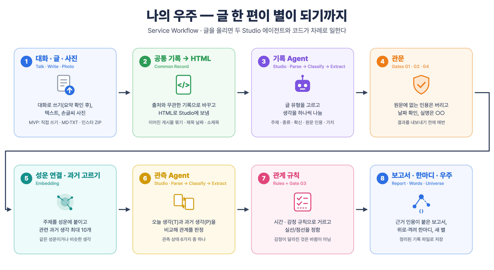

## 왜 만드는가

일기는 남는데 그 일기로 지금의 나를 이해하지 못합니다. 생각이 어떻게 바뀌었는지 알려면 지난 글을 직접 찾아 대조해야 하고, 처음 쓰는 사람은 쓸 거리가 막연해 기록이 쌓이지 않습니다.
나의 우주는 사람을 판정하지 않고 **관측**합니다. 원문에 적힌 생각만 별로 띄우고, 원문으로 확인되는 관계는 실선, AI 추정은 점선으로 그리며, 모르는 것은 질문으로 남깁니다.

| 대화로 쓰기 (목업) | 요약 확인 (목업) | 한마디 (목업) |
| --- | --- | --- |
| 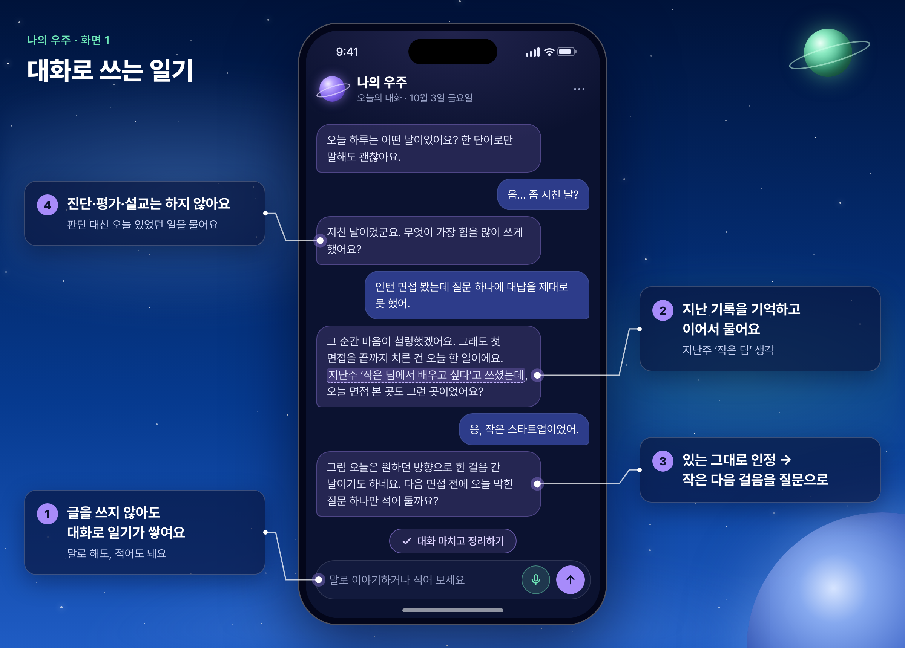 | 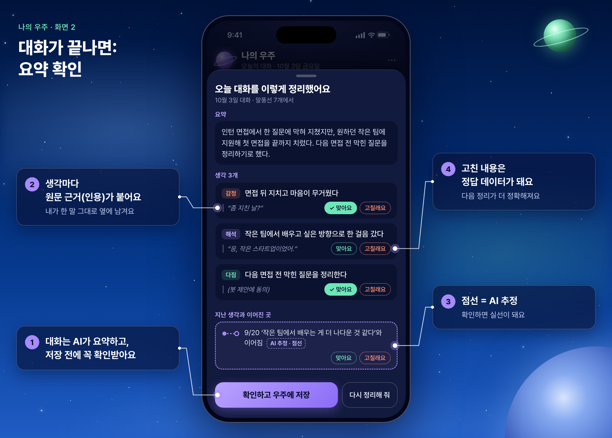 | 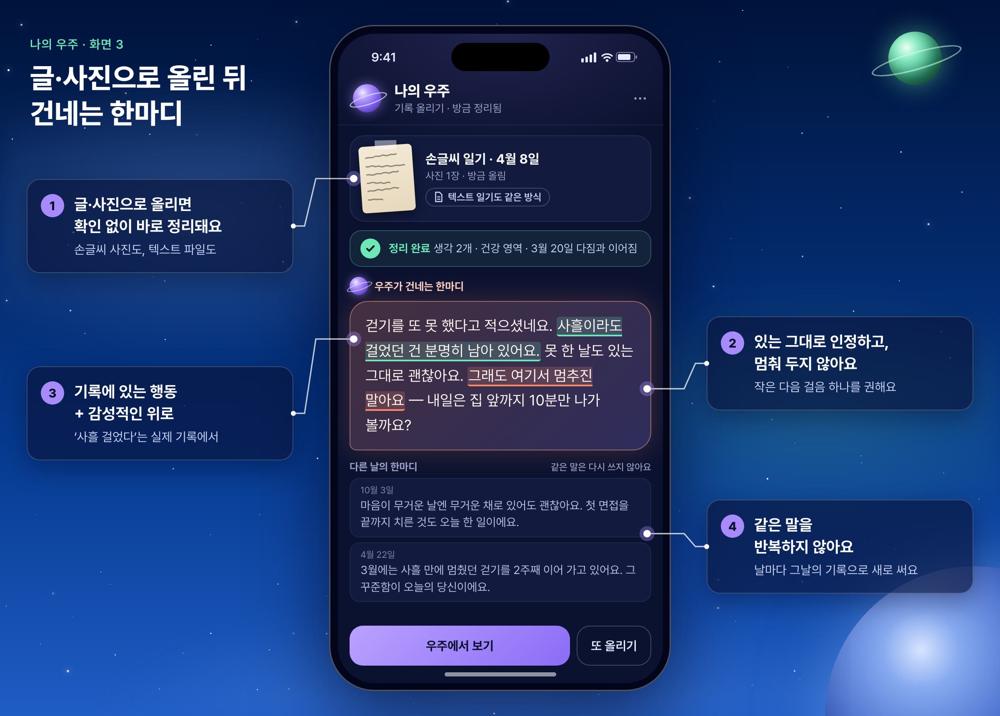 |

## 온톨로지 — 미리 정해 둔 표

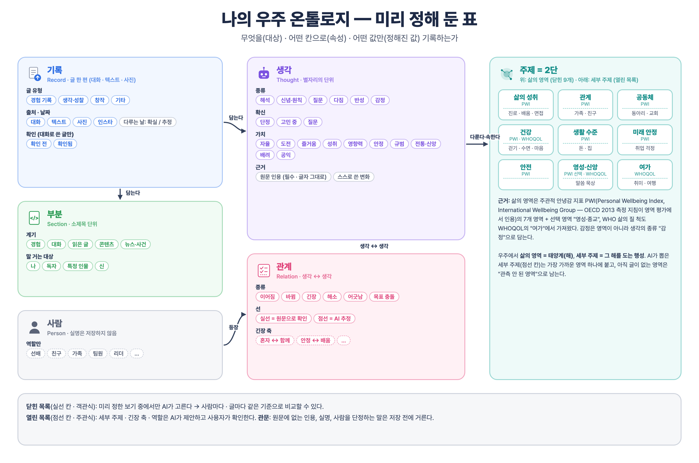

- **닫힌 목록(객관식):** AI가 정해 둔 보기 안에서만 고른다. 글 유형 4, 생각 종류 6, 확신 3, 가치 10, 관계 6, **삶의 영역 9**.
- **열린 목록(주관식):** 세부 주제 · 긴장 축 · 역할은 글에서 나온 말을 쓰고 사용자가 확인한다.
- **삶의 영역 9개**는 주관적 안녕감 척도 PWI(Personal Wellbeing Index, International Wellbeing Group — OECD 2013 측정 지침이 영역 평가에서 인용)의 7개 영역(삶의 성취 · 관계 · 공동체 · 건강 · 생활 수준 · 미래 안정 · 안전) + 선택 영역 영성·신앙, WHO 삶의 질 척도 WHOQOL의 여가에서 가져왔다. 세부 주제는 가장 가까운 영역 하나에 붙는다(`universe.py`의 `DOMAINS`).

## 전체 구조

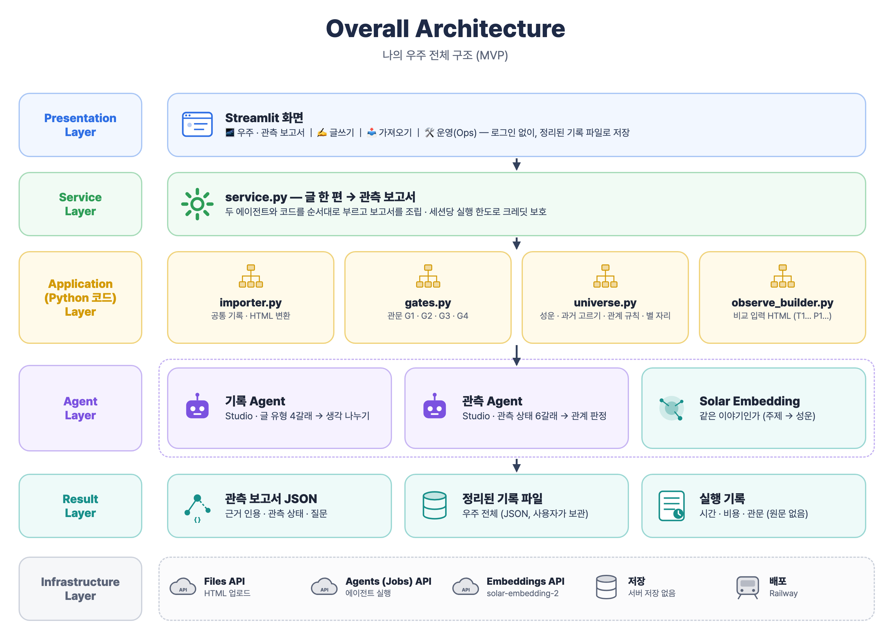

| 계층 | 파일 | 하는 일 |
| --- | --- | --- |
| 화면 | `streamlit_app.py`, `universe_view.py` | 우주 · 관측 보고서 / 글쓰기 / 가져오기 / 운영(Ops) |
| 서비스 | `service.py` | 글 한 편 → 관측 보고서 파이프라인, 세션 실행 한도 |
| 코드 | `importer.py` | 출처와 무관한 공통 기록, 인스타 글자 깨짐 복원 · 이어진 게시물 묶기 · 제목 속 날짜 · 소제목, HTML 변환 |
| | `gates.py` | 관문 G1 원문에 없는 인용 · G2 날짜 · G3 사람 단정 표현 · G4 실명 가리기 |
| | `universe.py` | 세부 주제 → 삶의 영역 연결, 관련 과거 생각 고르기, 관계 규칙, 별 자리 |
| | `observe_builder.py` | 관측 Agent에 보낼 비교 입력 HTML (오늘 생각 T1… · 과거 생각 P1…) |
| | `embedder.py` | Solar Embedding (같은 이야기인가만 판단) |
| 에이전트 | `agent_client.py`, `agent_configs/` | Studio 에이전트 실행(Files API + Jobs API, 재시도), Studio에서 내보낸 설정 |
| 운영 | `runlog.py`, `tools/` | 원문 없는 실행 기록, 가상 데이터 평가, 흔들림 측정, 입력 3종 시험, 그림 |

## Studio 에이전트

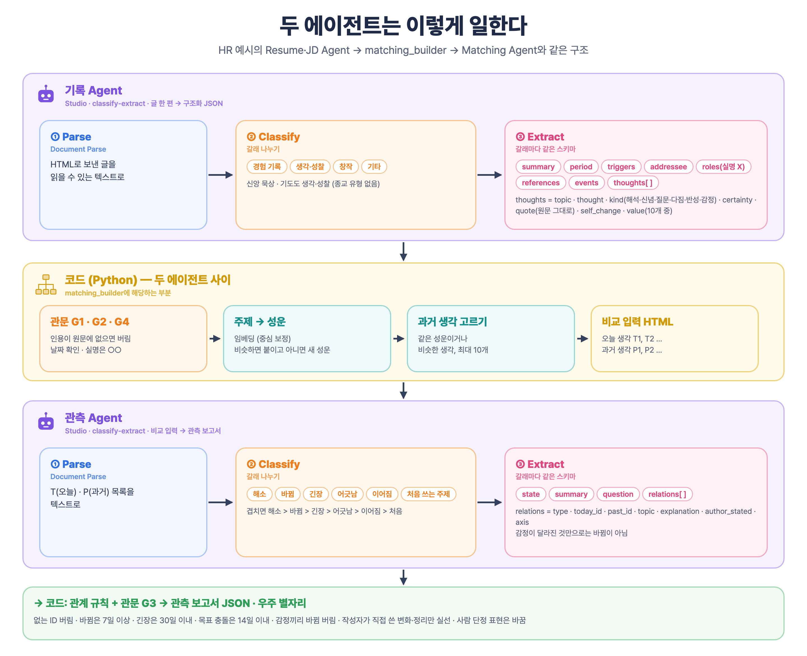

HR 예시의 `Resume·JD Agent → matching_builder → Matching Agent`와 같은 모양입니다.

| 에이전트 | 노드 | Classify 갈래 | Extract 스키마 |
| --- | --- | --- | --- |
| **기록 Agent** | Parse → Classify → Extract | 경험 기록 / 생각·성찰 / 창작 / 기타 | `summary` `period` `triggers` `addressee` `roles`(실명 X) `references` `events` `thoughts[]` = topic · thought · kind(해석·신념·원칙·질문·다짐·반성·감정) · certainty · quote(원문 그대로) · self_change · value |
| **관측 Agent** | Parse → Classify → Extract | 해소 / 바뀜 / 긴장 / 어긋남 / 이어짐 / 처음 쓰는 주제 | `state` `summary` `question` `relations[]` = type · today_id · past_id · topic · explanation · author_stated · axis |

- 설정 파일: `agent_configs/Record Agent.json`, `agent_configs/Observe Agent.json` (Studio에서 내보낸 원본, config #1)
- `tools/make_agent_configs.py`가 처음 가져오기(import)용 설정을 만들었습니다. Studio에서 고친 뒤에는 다시 내보내 `agent_configs/`를 바꿉니다.

**코드가 하는 판단 (에이전트 밖)**: 원문에 없는 인용은 버림 · 실명은 ○○ · 이어짐/바뀜/긴장/해소/어긋남은 같은 삶의 영역끼리만 · 다짐 뒤 30일 안의 반성은 어긋남 · 바뀜은 7일 이상, 긴장은 30일 이내 · 목표 충돌은 14일 안의 다짐 둘 · 감정이 달라진 것은 바뀜 · 해소가 아님 · 다짐이 지켜지면 이어짐 · 작성자가 직접 쓴 변화 · 정리만 실선.

## 실행 방법

```bash
uv venv --python 3.11 .venv && source .venv/bin/activate
uv pip install -r requirements.txt
cp .env.example .env        # 키와 에이전트 ID를 채운다

python app.py               # 가상 인물 "하늘"의 인스타그램 ZIP(게시물 30개 → 글 29편)을 처리
python app.py data/samples/2026-09-25-독서노트.md
streamlit run streamlit_app.py
```

`python app.py` 결과: `output/records.json`(정리된 기록 파일), `result/reports/<기록ID>.json`(글마다 관측 보고서), `result/observation_report.json`(마지막 글).

### 환경변수

| 이름 | 설명 |
| --- | --- |
| `UPSTAGE_API_KEY` | Upstage Console 키 (Studio 에이전트와 같은 조직) |
| `RECORD_AGENT_ID`, `RECORD_CONFIG_ID` | 기록 Agent ID와 설정 번호 |
| `OBSERVE_AGENT_ID`, `OBSERVE_CONFIG_ID` | 관측 Agent ID와 설정 번호 |
| `MAX_JOBS_PER_SESSION` (선택, 기본 40) | 세션당 Studio 실행 상한 (공개 배포에서 크레딧 보호) |
| `MAX_IMPORT_POSTS` (선택, 기본 10) | 가져오기 한 번에 관측하는 글 수 |
| `DISK_CACHE` (선택, 기본 0) | 1이면 추출 결과를 디스크에 캐시 (로컬 개발 전용) |

### 배포 (Streamlit Community Cloud)

1. [share.streamlit.io](https://share.streamlit.io)에 GitHub 계정으로 로그인 → 이 저장소 접근 허용
2. Create app → 저장소 `my-universe`, 브랜치 `master`, 파일 `streamlit_app.py`
3. Advanced settings → Python 3.11, Secrets에 아래를 붙여 넣기 (최상위 값이 환경변수로 들어간다)

```toml
UPSTAGE_API_KEY = "..."
RECORD_AGENT_ID = "agt_..."
RECORD_CONFIG_ID = "1"
OBSERVE_AGENT_ID = "agt_..."
OBSERVE_CONFIG_ID = "1"
```

4. Deploy → 접속하면 데모 우주(가상 인물 하늘)가 먼저 보입니다. Railway에서도 `Procfile` 그대로 돌아갑니다.

## 평가와 운영(Ops)

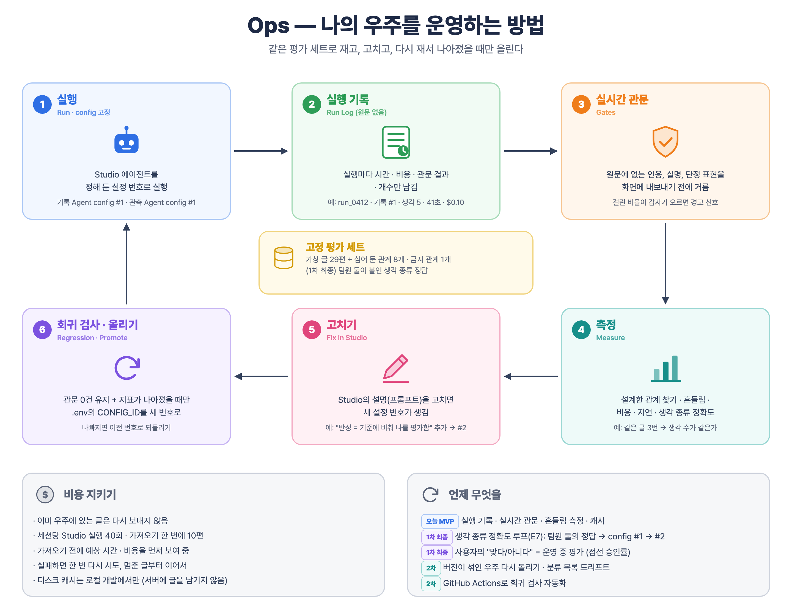

- **관문 (0건이어야 함)**: G1 원문에 없는 인용, G2 추정 표시 없는 틀린 날짜, G3 사람을 단정하는 표현, G4 다른 사람 실명 노출. 평가 때만이 아니라 **모든 실행에서** 결과를 내보내기 전에 거릅니다.
- **실행 기록**: `runs/run_log.jsonl`. 글 원문과 인용은 남기지 않고 실행 ID · 설정 번호 · 시간 · 페이지 · 추정 비용 · 관문 결과 · 개수만 남깁니다. 화면의 🛠 운영 탭에서 봅니다.
- **가상 데이터 평가**: `python tools/eval_virtual.py`. 가상 글을 쓸 때 심어 둔 관계 8개(바뀜 · 긴장 · 해소 · 어긋남 · 목표 충돌 · 이어짐)와 금지 관계 1개(감정만 달라진 것)를 얼마나 찾는지 잽니다. 결과: `data/ops/eval_virtual.json`.
- **흔들림 측정**: `python tools/stability.py`. 같은 글 3편을 3번씩 돌려 유형 · 생각 수 · 종류 · 인용이 같은지 잽니다. 결과: `data/ops/stability.json`.
- **입력 3종 시험**: `python tools/test_inputs.py` (MD, TXT, 직접 쓰기) + `python app.py` (인스타그램 ZIP).
- **설정 버전**: 실행은 `.env`의 `*_CONFIG_ID`로 고정합니다. Studio 설명을 고치면 새 config 번호가 생기고, 같은 평가 세트로 다시 재서 나아졌을 때만 번호를 올립니다. 나빠지면 이전 번호로 되돌립니다.

평가 결과 요약은 아래 "MVP 측정 결과"에 있습니다.

## 데이터 원칙

- 시연과 평가 숫자는 **가상 인물 "하늘"**의 글로만 만듭니다(`tools/make_virtual_data.py`). 실제 인스타그램 내보내기와 구조(글자 깨짐, 이어진 게시물, 제목 속 날짜, P1 소제목)만 같습니다.
- 공개 서버는 사용자의 글을 저장하지 않습니다(디스크 캐시 꺼짐). 우주는 브라우저 세션에만 있고, 사용자가 정리된 기록 파일로 보관합니다.
- 사람 이름은 역할로 바꾸거나 ○○로 가립니다.

## 가이드 고도화 포인트 적용

| 포인트 | 적용 |
| --- | --- |
| 1 서비스 정체성 | 이름 · 한 줄 소개 · 사이드바 · 푸터 · 어두운 우주 테마 |
| 2 입력 경험 | ZIP · MD · TXT 업로드, 형식 안내, "저장하고 관측하기" |
| 3 결과 화면 | 2D 우주(별 카드, 가치 보기), 관측 보고서, 처리 시간 · 추정 비용 표시 |
| 4 에이전트 품질 | 감정 규칙 · 관측 상태 우선순위를 Studio 설명에 넣음, 생각 종류 경계 설명 |
| 5 안정성과 진행 표시 | 실패 시 한 번 재시도, 단계별 진행 표시, 실패해도 글 유지 · 이어서 진행 |
| 6 결과 활용 | 관측 보고서 JSON, 정리된 기록 파일 내려받기 · 올리기 |
| 8 구조 확장 | 일괄 분석(인스타그램 ZIP 가져오기, 이어진 게시물 묶기) |

## MVP 측정 결과 (2026-10-03, 기록 Agent config #1 · 관측 Agent config #1)

| 측정 | 결과 | 비고 |
| --- | --- | --- |
| 입력 3종 + ZIP | MD · TXT · 직접 쓰기 · 인스타그램 ZIP 모두 끝까지 실행 | `data/ops/input_tests.json` |
| 관문 G1~G4 | 원문에 없는 인용 0 · 날짜 문제 0 · 단정 표현 0 · 보고서 속 실명 노출 0 (이름 2개를 ○○로 가림) | 가상 글 29편 |
| 설계한 관계 찾기 | 두 글 짝 8/8, 관계 종류 7/8, 실선/점선 일치 7/7, 금지 관계(감정만 달라짐 → 바뀜) 0건 | `data/ops/eval_virtual.json` |
| 흔들림 | 같은 글 3편 × 3번: 글 유형 · 생각 수 · 생각 종류 3/3 같음, 인용 겹침 1.0 | `data/ops/stability.json` |
| 지연 | 기록 Agent 평균 30.6초, 관측 Agent 평균 32.6초 → 글 한 편 약 1분 | Studio Jobs API |
| 비용 | 가상 글 29편 첫 처리: Studio 실행 50회, 추정 $2.40 (글당 약 $0.08) | Parse $0.01 + Extract $0.04 / 쪽 |

**놓친 것과 한계**

- 놓친 1개: 4/5 "혼자가 편하다" → 4/12 "함께해야 성장한다, 어느 쪽이 진짜 나일까"를 긴장이 아니라 바뀜(작성자가 직접 씀)으로 읽었습니다. 두 해석 모두 가능한 글입니다.
- 설계 밖에서 찾은 관계 31개를 눈으로 보니 약 3분의 2는 그럴듯하고 약 3분의 1은 약하거나 틀렸습니다(예: 리더십 질문 → 독서노트 사이의 바뀜). 다음 평가 루프에서 관측 Agent 설명을 고칠 대상입니다.
- 관계 규칙 4개(같은 두 글 사이 관계 하나, 질문 → 신념은 해소, 실선은 스스로 쓴 변화가 있을 때만, 주제는 PWI · WHOQOL 기반 삶의 영역 9개에 붙임)는 이 가상 데이터를 보고 PRD 규칙을 코드로 옮긴 것이라, 같은 데이터로 잰 위 숫자는 낙관적입니다. 팀원 둘이 따로 쓴 글로 다시 잽니다(E7).
- 주제 낱말은 Solar Embedding 2로 그대로 비교하면 어떤 쌍이든 0.70~0.87이 나와서(실측), 흔한 주제 낱말 50개의 평균 벡터를 빼고 비교합니다.

| 우주 화면 | 관측 보고서 |
| --- | --- |
| 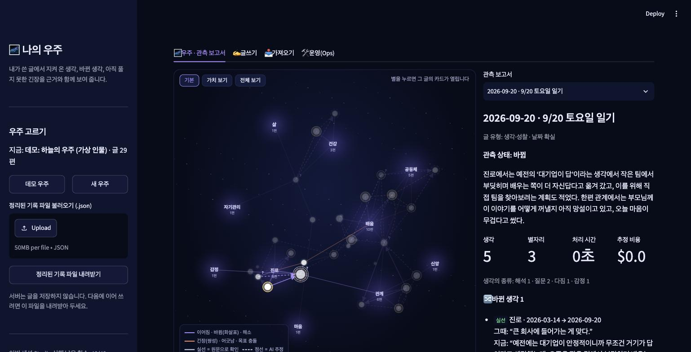 | 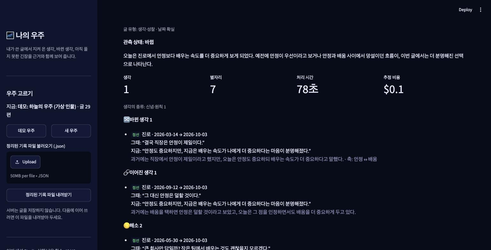 |

Studio 관측 Agent 실행 화면: 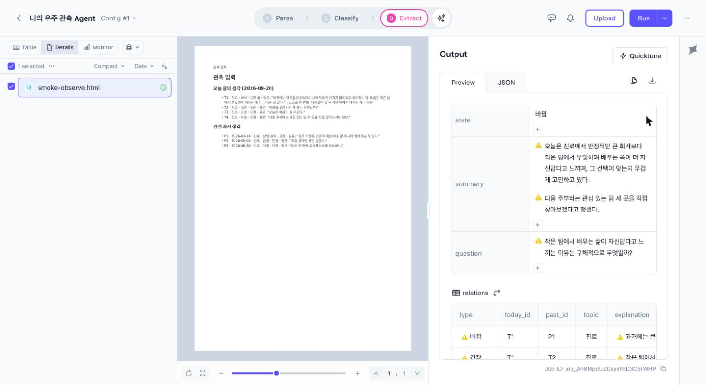
