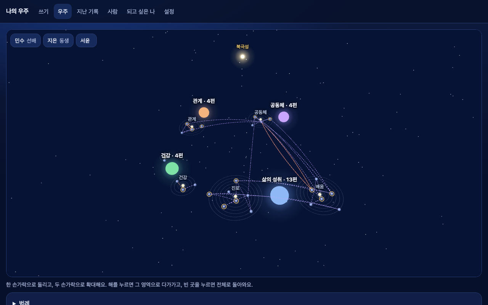

# Docker 3개 실제 백엔드 확인 (2차 가이드 ⑥)

2026-10-08 밤. master(`7265fc9`)의 `docker-compose.yml`로 실제 `main.py` 백엔드 · 화면 · ChromaDB를 띄워 확인했다.
다른 project 이름과 포트로 띄워 개발용 스택(`supabase_*_my-universe`, `my-universe-chroma`)과 겹치지 않게 했다. 유료 호출(일기 쓰기)은 하지 않았다.

```bash
COMPOSE_PROJECT_NAME=v8check CHROMA_HOST_PORT=18000 BACKEND_HOST_PORT=18001 FRONTEND_HOST_PORT=18002 scripts/start_docker.sh
docker compose -p v8check down -v --rmi local     # 끝나고 컨테이너 · 네트워크 · 볼륨 · 이미지 지움
```

백엔드는 로컬 Supabase(`host.docker.internal:54321` · `54322`)와 compose 안의 `chroma`에 붙었다. 컨테이너용 값은 `start_docker.sh`가 `.env.local`에서 만든 `.env.docker.local`(gitignore, 로컬 데모 값만)에서 읽었다.

## 결과

| 확인 | 결과 |
| --- | --- |
| 이미지 빌드 | 백엔드 918MB · 화면 1.08GB, 오류 없음 |
| ChromaDB `GET :18000/api/v2/heartbeat` | 200 |
| 백엔드 `GET /health` | `{"status":"ok","version":"0.8.0"}` |
| 백엔드 `GET /ontology` | 200 (36KB) |
| 백엔드 → compose ChromaDB | `CHROMA_HOST=chroma`, Cloud 키 비움, heartbeat · `thoughts` 컬렉션 확인 |
| 해 분류 기준 축 벡터(`data/ops`) | 고친 뒤 9개 축 + 중심 읽힘 (고치기 전엔 이미지에 파일이 없어 빈 값) |
| 시험용 계정 토큰으로 `GET /me` | 200, 하늘 데모 29편 · 되고 싶은 나 있음 · 날씨 질문 끝남 |
| `GET /universe` | 200, 해 4 · 작은 별 6 · 행성 25 · 선 35 · 북극성 |
| `GET /diary` | 200, 20편(한 쪽) |
| 토큰 없이 `GET /me` | 401 |
| CORS(`Origin: http://localhost:18002`) | 허용 |
| 화면 `GET :18002/` | 200 |
| 화면 로그인 → 우주(Playwright 헤드리스) | 백엔드 호출 오류 0, 캡처 ↓ |
| `logs/agent_flow_YYYYMMDD.log` | 생김(컨테이너 `/srv/logs` → `./logs`). 25줄 모두 `ts · event · method · path · http · ms`만, 원문 · 이름 · 토큰 없음 |
| 정리 | `v8check` 컨테이너 3 · 네트워크 · 볼륨 · 이미지 2 지움. 개발용 스택은 건드리지 않음 |



## 고친 것

| 문제 | 고침 |
| --- | --- |
| 백엔드가 실행 중에 `data/ops/domain_aliases_*.json` · `topic_center_*.json`(해 분류용 기준 축 벡터)을 읽는데 이미지 · Vercel 업로드 둘 다에서 빠져 있었다. 파일이 없으면 조용히 빈 값이 된다 | `.dockerignore`에서 두 파일만 다시 넣고 `Dockerfile`에서 COPY. `.vercelignore`는 `/data/*` + `!` 로 두 파일만 올리고, `vercel.json` `excludeFiles`에서 `data/**`를 뺐다(나머지 `data/`는 `.vercelignore`가 이미 막음, `git check-ignore`로 확인) |
| 컨테이너가 UTC라 로그 파일 이름 · 시각이 하루 어긋남(`agent_flow_20261007.log`, `+00:00`) | `Dockerfile`에 `TZ=Asia/Seoul` |
| 로컬 Supabase로 Docker를 띄우려면 `.env.docker.local`을 손으로 만들고 화면 빌드 인자(anon 키 등)를 따로 넘겨야 했다 | `start_docker.sh`가 `.env.local` → `.env.docker.local`(주소만 `host.docker.internal`, 이미 있으면 그대로)을 만들고, `infra/frontend/.env.local`에서 `NEXT_PUBLIC_*`를 읽는다 |
| 기본 포트 8000이 개발용 `my-universe-chroma`와 겹침 | `start_docker.sh`가 기본 포트일 때 `my-universe-chroma`를 끈다(데이터는 남음) |
| 문서의 **(WS5 확인)** 표시 · 제안 이름(`MAX_ENTRIES_PER_DAY` · `MONTHLY_BUDGET_USD`) | 실제 이름 `DAILY_ENTRY_LIMIT`(기본 10) · `MONTHLY_COST_CAP_USD`(기본 5) 등으로 `deploy/MORNING.md` ⑤ · `deploy/README.md` §4 · §5 · §6을 고침 |

## Vercel 진입점

`pyproject.toml`의 `[tool.vercel] entrypoint = "모듈:변수"`는 공식 문서에 있다(https://vercel.com/docs/frameworks/backend/fastapi, "Exporting the FastAPI application"). `pyproject.toml`은 공통 파일이라 고치지 않고, 동규가 아침에 넣을 두 줄을 `deploy/MORNING.md` ①에 적었다:

```toml
[tool.vercel]
entrypoint = "main:app"
```

넣지 않아도 지금 방식(`.vercelignore`가 1차 `app.py`를 빼서 기본 탐색이 `main.py`를 잡음, `vercel.json` 함수 키 `main.py`)으로 동작한다. `.vercelignore`의 `!` 다시 넣기는 공식 문서의 allowlist 예시와 같은 문법이다(https://vercel.com/docs/deployments/vercel-ignore).

## 남은 것

- compose의 ChromaDB는 새 볼륨이라 하늘 데모의 생각 벡터가 없다. 우주 · 목록은 DB만 쓰니 그대로 보이고, "지난 생각 고르기"는 Docker 안에서 쓴 글부터 쌓인다.
- 로그 시각은 컨테이너 시간대를 따른다(앱의 `APP_TIMEZONE`과 따로). Vercel(UTC)에서는 로그 시각이 UTC로 찍힌다.
