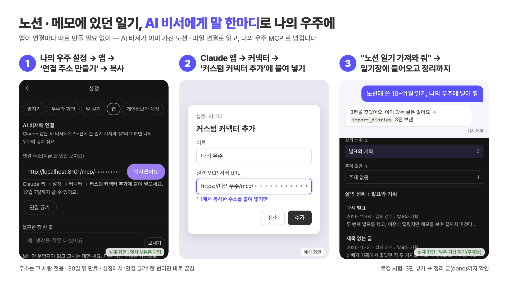

# 나의 우주 MCP(2026-11-07 운영 반영) — AI 비서로 일기 가져오기

노션 · 메모 앱 · 파일에 써 둔 일기를 **AI 비서(Claude 앱 등)에게 말 한마디로** 나의 우주에 넣는 길이다.
AI 비서는 이미 노션 · 파일 같은 곳에 연결돼 있으니, 나의 우주는 연결마다 따로 만들 필요 없이 "받는 문" 하나만 열면 된다.

```
노션 · 메모 · 파일 ──(AI 비서가 이미 가진 연결로 읽음)──> AI 비서 ──(나의 우주 MCP 도구)──> 나의 우주(기록 · 정리)
```



## 사용자는 이렇게 연결한다(추천: 원격 MCP 주소 하나)

1. **나의 우주 설정 → 앱 → 'AI 비서에 연결' → 연결 주소 만들기 → 복사.** 운영 주소는 `https://my-universe-api.vercel.app/mcp/<열쇠>` 모양. 그 사람 전용이고 만들 때 한 번만 보인다.
2. **Claude 앱 → 설정 → 커넥터 → '커스텀 커넥터 추가'**에 이름(나의 우주)과 주소만 붙여 넣는다.
3. AI 비서에게 **"노션에 쓴 10~11월 일기 나의 우주에 넣어 줘"** → 일기장에 들어오고, 앱에서 쓴 글과 똑같이 정리된다.

고른 이유: 토큰 복사 · 설정 파일 고치기 · 파이썬 설치가 없는 쪽이 사용자에게 가장 쉽다. 주소 하나를 붙이면 끝나고, 끊는 것도 설정에서 단추 하나다.

- **열쇠:** 주소 끝의 열쇠 = 사용자 id · 열쇠 id · 만료를 사용자별 HMAC 으로 서명한 것. 서버는 지금 열쇠 id · 만료만 설정(암호화)에 둔다.
  **30일 뒤 만료**, 설정의 **'연결 끊기'**나 새 주소를 만들면 예전 주소는 바로 안 된다. 이 열쇠로는 아래 도구 셋만 쓸 수 있다(다른 API 는 안 열림).
- **서버:** [`app/api/mcp_link.py`](../app/api/mcp_link.py) — `POST /mcp/{열쇠}` 가 MCP(Streamable HTTP, 상태 없는 JSON 응답)를 받는다. 새 의존성 없음.
  설정 칸은 [`infra/frontend/app/settings/page.tsx`](../infra/frontend/app/settings/page.tsx) 의 `AiLink`.
- 정리는 새 길을 만들지 않았다: 앱 '지난 일기 가져오기'와 같은 기록 만들기(`/diary` 와 같은 동의 · 하루 글 수 · 월 비용 상한 · 같은 글 확인) → 같은 정리 그래프.
- **Vercel 에서도 끝까지:** 도구는 바로 답하고(1초쯤), 정리는 같은 주소로 한 번 더 보낸 내부 요청 `x/run` 이 맡는다. 그 응답은 `/diary/stream` 과 같은 흘려보내는 SSE(`_Drain`)라
  보낸 쪽이 끊어도 끝까지 돈다. 함수 한도 300초 안에서 새 글은 170초까지만 시작하고, 남은 글은 다음 `x/run` 으로 넘긴다. `x/run` 은 우리가 만든 본문 모양(가져온 글 · 텍스트)만 50편까지 받는다.
- 입력 검사 · 도구 설명은 [`app/service/mcp_input.py`](../app/service/mcp_input.py) 하나(원격 · stdio 판이 같이 씀).

## 도구 셋

| 도구 | 하는 일 | 돌려주는 것 |
| --- | --- | --- |
| `import_diaries(entries)` | 지난 일기 여러 편(한 번에 **50편까지**)을 넣는다. 한 편 = `{text, date?, title?}` | 받은 편수 · 기다리는 편수 · 어림 시간(분) |
| `write_diary(text, date?, title?)` | 일기 한 편을 쓴다(앱 쓰기 화면과 같은 출처 '텍스트') | 위와 같음 |
| `recent_diaries(n)` | 최근 기록 n편(1~100)의 **날짜 · 제목 · 정리 상태만**. 본문 · 요약은 돌려주지 않는다 | `done` 끝 · `processing` 정리 중 · `failed` 멈춤, 기다리는 편수 |

- **바로 돌려주고 정리는 뒤에서 한다.** 정리가 한 편에 1분쯤 걸려 AI 비서가 기다리다 끊지 않게, 도구는 받기만 하고 서버가 차례로 정리한다. 끝났는지는 `recent_diaries` 로(`processing` = 정리 중인 편수).
- **오래된 글부터** 정리한다(앱 가져오기와 같음). 날짜를 모르는 글은 맨 뒤.
- **같은 글을 다시 넣어도 다시 정리하지 않는다.** 가져온 글마다 '같은 원본' 표시(`mcp:` + 날짜 · 제목 · 본문의 해시)를 붙여 서버가 알아본다.
- **받기 전에 검사한다:** 빈 글, 8,000자 넘는 글, 120자 넘는 제목, `YYYY-MM-DD` 가 아닌 날짜, 앞으로의 날짜, 50편 넘게.
  하나라도 틀리면 아무것도 보내지 않고 몇 번째 글이 왜 틀렸는지 알려 준다. 동의 여부도 먼저 본다.
- 날짜를 주면 그날을 '글이 다루는 날'(확실)로, 쓴 시각은 그날 낮 12시로 넣는다. 날짜가 없으면 서버가 제목 · 본문 속 날짜를 읽고, 없으면 오늘로 어림한다.
- 한 편마다 AI 정리가 돌아 비용이 든다(한 편 $0.1~0.15쯤). 도구 설명에 "몇 편 넣을지 사용자에게 먼저 확인"을 적어 두었다.

## 개발자용: 로컬 stdio 판

같은 도구 셋을 파일 하나로: [`tools/mcp_diary.py`](../tools/mcp_diary.py). 앱 API(`POST /diary`)를 액세스 토큰으로 부른다.
`mcp` 는 프로젝트 의존성에 넣지 않았다(파일 맨 위 스크립트 머리말로 `uv run` 이 따로 받음).

```json
{
  "mcpServers": {
    "my-universe": {
      "command": "uv",
      "args": ["run", "--quiet", "/저장소/경로/tools/mcp_diary.py"],
      "env": { "MY_UNIVERSE_API": "http://localhost:8001", "MY_UNIVERSE_TOKEN": "액세스 토큰" }
    }
  }
}
```

`env` 에 꼭 적는다(AI 비서가 띄우는 서버는 터미널 환경변수를 물려받지 않음). 액세스 토큰은 1시간이면 풀려서 사용자용이 아니다.

## 실제로 돌려 본 결과(로컬, 2026-11-07)

| 시험 | 어떻게 | 결과 |
| --- | --- | --- |
| **운영 반영** | master `a5985d8` → Vercel(my-universe-api · my-universe) | `/health` 200, `/mcp/<틀린 열쇠>` → 우리 401 안내. 전체 시험 840개(로컬 DB 포함) · GitHub CI 통과. 운영에서 시험 계정으로 1편 넣기는 아래 '남은 것' 1 |
| **Vercel 방식(내부 요청 x/run) 로컬 확인** | 임시 https 주소(cloudflared) → worktree 백엔드, 가상 일기 1편 | 도구 답 1.1초, done 65초 |
| **Claude 앱 실제 연결** | claude.ai → 커스텀 커넥터 추가에 연결 주소(cloudflared 임시 주소 → worktree 8102) → 연결됨 · 도구 3개. 새 대화에 가상 일기 3편을 붙여 "나의 우주에 넣어 줘" | Claude 가 `recent_diaries` → `import_diaries` 를 스스로 부름 → **3편 모두 done, 약 4분**. "다 됐는지 확인해 줘" → Claude 가 다시 확인해 "세 편 모두 정리가 끝났어요". 유료 호출 15번 약 $0.30 |
| 원격(추천 길) | worktree 백엔드 8101 · 화면 3100, 새 시험 계정 → 설정 '연결 주소 만들기' → 받은 주소로 MCP 클라이언트(공식 `mcp` SDK, Streamable HTTP) | 가상 일기 3편 → **3편 모두 done, 167초**(35 · 101 · 167초). 일기장 '주제별'에 들어옴. 틀린 입력은 안내 문구, 틀린 주소는 401 |
| 로컬 stdio | 앱 백엔드 8001, 새 시험 계정 → `uv run --with "mcp>=2,<3" python -m tools.mcp_diary_live` | 가상 일기 3편 → **3편 모두 done, 242초**. 같은 3편 다시 넣기 → 새 기록 0편 |
| 단위 시험 | `tests/test_mcp_diary.py`(가짜 HTTP) · `tests/test_mcp_link.py`(가짜 저장소) | 13개 통과. 열쇠: 위조 서명 · 남의 id · 만료 바꿈 · 끊은 뒤 · 새 주소 뒤 예전 주소 모두 401 |

- 비용(백엔드 기록 기준): 원격 3편 유료 호출 16번 약 $0.26, stdio 3편 25번 약 $0.31. `runs/cost_ledger.jsonl` 에 적음.
- 시험 계정은 둘 다 끝나고 지웠다(`DELETE /me`: 벡터 · 기록 · 계정). 시연 계정 · 8001 · 3000 은 건드리지 않음.
- 화면 사진(열쇠 부분은 가림): [설정](images/mcp/1-settings.png) · [Claude 커넥터 연결됨](images/mcp/2-claude-connected.png) · [Claude 확인 답](images/mcp/3-claude-done.png) · [일기장 주제별](images/mcp/3-diary-topics.png).

## 한계(시험판)

- **Claude 앱 연결은 임시 터널로 해 봤다.** 커스텀 커넥터는 인터넷에서 닿는 주소가 필요해서(localhost 안 됨) cloudflared 임시 주소로 열었다. 운영 주소에서는 터널 없이 된다.
- **주소 자체가 열쇠다.** 주소가 새면 30일 동안 그 사람 일기를 넣고 목록(날짜 · 제목)을 볼 수 있다 → 그래서 기한 · 끊기를 두었다.
  Claude 커넥터 추가 창에 '요청 헤더'(API 키) 칸이 있어서, 열쇠를 주소 대신 헤더로 받게 바꾸면 주소가 새도 안전하다. 그다음은 MCP 표준 OAuth.
- **정리 차례는 요청 흐름에만 있다(DB 큐 아님).** `x/run` 이 중간에 실패하면 남은 글은 다시 넣어야 한다(이미 넣은 글은 건너뜀).
- **멈춘 글(`failed`)은 앱에서 '이어서 하기'.** MCP 로 다시 넣으면 '이미 보낸 글'로 막힌다.
- 사진 · 인스타그램 ZIP 은 이 도구로 받지 않는다(앱 가져오기 화면). 본문을 고치지 않고 넘기는지는 AI 비서에게 달렸다(도구 설명으로 부탁만).

## 운영에 올리려면 남은 것

1. **운영에서 한 편 넣어 done 까지 확인**(운영은 구글 로그인만이라 시험 계정 토큰을 관리 키로 만들어야 해서 권한 확인 대기) — 가장 쉬운 길은 동규 계정으로 앱 설정에서 주소를 받아 Claude 커넥터에 붙이고 한 편 넣어 보기. 실제 노션 연결로 가져오기도 그때.
2. 열쇠를 요청 헤더로 받기(Claude 커넥터의 '요청 헤더' 칸), 다음에 MCP 표준 OAuth. 그 전까지는 지금처럼 기한 · 끊기.
3. 정리 차례를 DB 로(중간 실패에도 이어지게), 사용자별 하루 편수 · 비용 안내.
4. 개인정보 안내에 "AI 비서를 거쳐 들어온 글"을 적기(외부 AI 로 나가는 길은 앱과 같음).
