# 나의 우주 v8 · 기술 설명서 (현호용)

작성 2026-10-08, **최신화 2026-10-17**: 10/14 운영 반영 세 번(이야기하기 · 사진 · 말로 쓰기 · 인스타그램 가져오기 · 우주 고치기 · 꾸미기 · 운영 화면 등)과 분석 설정 4판(기록 #5 · 관측 #4)을 반영했다(master `f92db72`, 테스트 701개 통과). 현호가 쓰면서 읽는 문서다.

- 읽는 법: 1장만 읽어도 쓰는 데 문제없다. 특히 1.4 "개인정보 약속"은 꼭 읽는다. 2장부터는 "안에서 무슨 일이 일어나는지"다.
- 주소: 화면 https://my-universe-seven.vercel.app · 백엔드 https://my-universe-api.vercel.app. 휴대폰에서는 홈 화면에 추가하면 앱처럼 쓴다(설치형 웹앱).
- 코드 이름 · 숫자는 지금 코드에서 그대로 옮겼다.
- 모든 예문과 화면은 가상 인물(하늘 · 서윤 · 지호 등)의 것이다. 실제 일기는 이 문서에 없다.

---

## 1. 한눈에 보기

### 1.1 나의 우주가 하는 일

별지기와 이야기하거나 일기를 쓰면 AI가 글을 **생각 단위**로 나누고, 지난 일기의 생각과 어떻게 이어지는지 찾아 **우주**로 그려 준다. 해는 삶의 영역(예: 관계, 건강), 해 곁의 작은 별은 세부 주제(예: 룸메이트와의 거리), 그 둘레를 도는 행성은 일기 한 편이다. 그리고 별지기가 오늘 글에 **한마디**를 건넨다. 판정하지 않고, 원문에 근거해서, 고른 말투로.

| 쓰는 길 | 어떻게 | 정리 전에 내가 확인하는 것 |
| --- | --- | --- |
| **이야기하기**(첫 화면) | 별지기가 먼저 묻고, 글이나 말로 답한다 | 대화를 마치면 '요약 확인'에서 맞아요 · 고칠래요 뒤 저장 |
| 직접 쓰기 | 제목 · 글이 다루는 날 · 본문. 글 파일(.txt · .md)도 불러온다 | 쓴 그대로 정리 |
| 사진에서 글자 읽기 | 손글씨 · 일기장 사진(여러 장이면 한 편) | 읽은 글을 쓰기 칸에서 고친 뒤 정리 |
| 인스타그램 가져오기 | 인스타그램 내보내기 ZIP | 가져올 편수를 고름 |

| 정리하면 | 보이는 것 |
| --- | --- |
| 진행 표시 | "글을 살펴보는 중 → 생각을 나누는 중 → …" 7단계 |
| 결과 카드 | 요약, 생각 목록(종류 · 확신), 지난 생각과 이어진 선, 한마디, 다음 질문, 관측 보고서 |
| 우주 | 해 · 작은 별 · 행성, 이어진 선, 쌍행성(긴장), 블랙홀(오래 머문 고민), 금빛 고리(다짐), 북극성(되고 싶은 모습) |

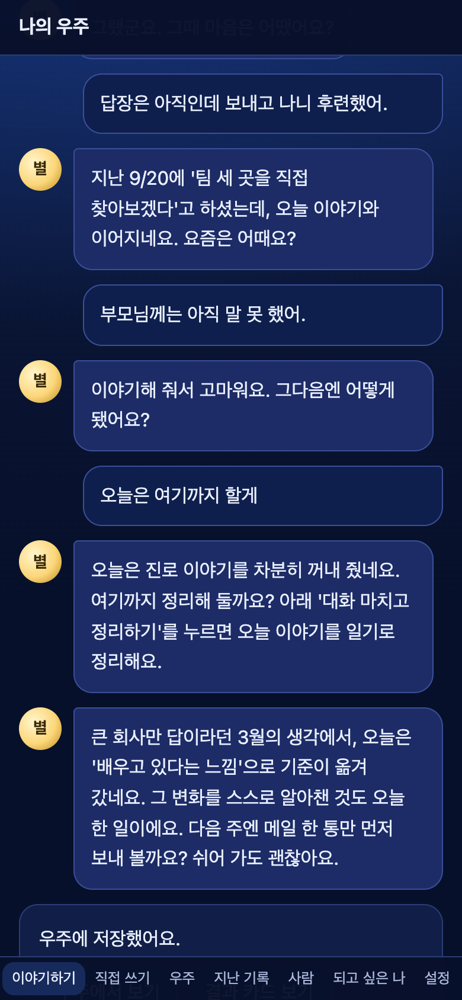 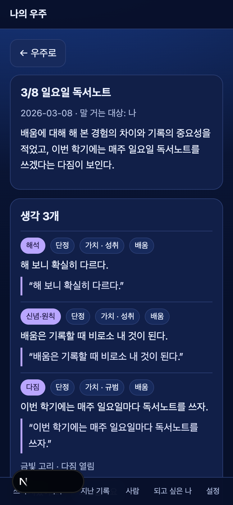 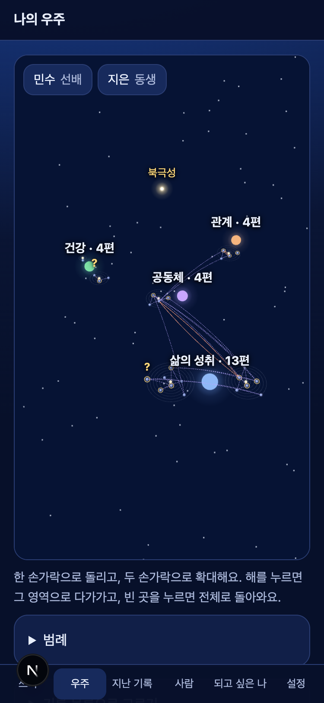

### 1.2 화면 (아래 메뉴)

| 메뉴 | 하는 일 |
| --- | --- |
| **이야기하기** | 로그인하면 처음 뜨는 화면. 별지기와 대화하다 '대화 마치고 정리하기' → 요약 확인 → '확인하고 우주에 저장'. '말로 하기'(마이크) · '녹음 파일 올리기'로 말로 해도 된다. '별지기 말 읽어 주기'를 켜면 별지기 말을 소리로 들려준다(기본 꺼짐). 확인 전 대화는 다른 기기에서 이어 한다 |
| 직접 쓰기 | 위에 별지기 말풍선(첫 만남 질문 · 지난번 '다음에 써 볼 질문' · 다짐 안부와 지켰어요 / 그만둘래요). 제목 · 글이 다루는 날(비우면 오늘) · 마음 날씨(골라도 되고 건너뛰어도 됨). 글 파일(.txt · .md) 불러오기, 사진에서 글자 읽기, 말로 쓰기, '인스타그램 글 한꺼번에 가져오기' 링크. 같은 글을 다시 올리면 '이미 정리한 글이에요'로 알려 준다 |
| 우주 | 한 손가락으로 돌리고 두 손가락으로 확대, 해를 누르면 그 영역으로 다가간다. 행성을 누르면 카드(그때 인용 → 지금 인용, 생각 종류 · 가치 고치기). 아래 '우주 고치기'에서 해 띄우기 · 작은 별 옮기기 · 합치기 |
| 지난 기록 | 쓴 글 목록. 기록마다 결과 다시 보기 · '날짜 확인 필요'면 날짜 고르기 · 지우기, 맨 위 '모든 기록 파일로 내려받기(JSON)' |
| 사람 | 글에 나온 사람 목록(외부 AI에 보낼 때 쓰는 가명 표). 별명 · 관계 말, 얽힌 생각 펼치기, 지우기('그 사람이 나온 생각도 지우기' 선택) |
| 되고 싶은 모습 | 되고 싶은 모습을 적으면 우주에 북극성이 뜨고, 그 모습에 닿은 순간이 있는 행성이 빛난다 |
| 설정 | 별지기 이름 · 말투 4종(팩폭은 경고 확인 뒤), 다음 걸음 제안 빈도(적게 · 보통 · 많이), 다른 영역과 이어진 선 보이기(숨김 · 눌렀을 때 · 항상), 꾸미기(테마 4벌 · 별지기 모습 5가지), 불편한 점 한 줄, 계정과 모든 기록 지우기 |

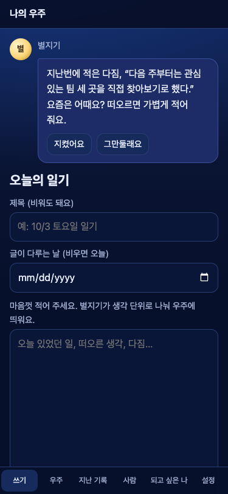 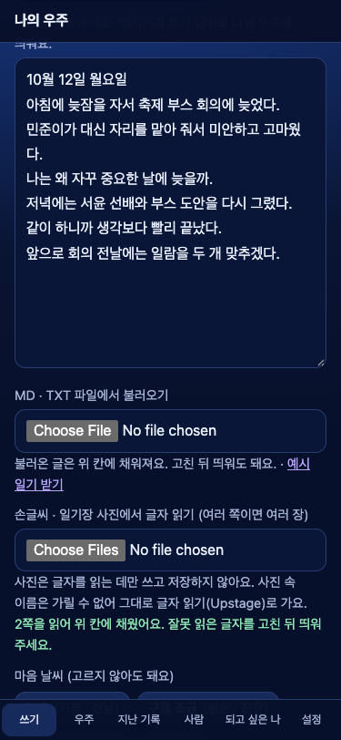 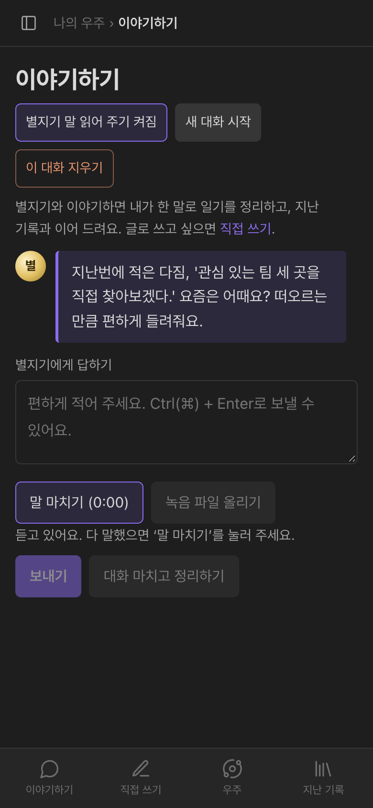 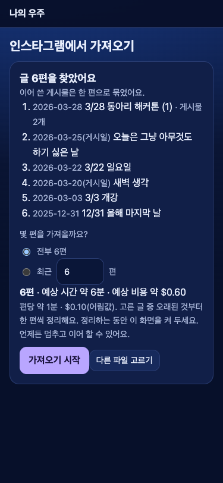

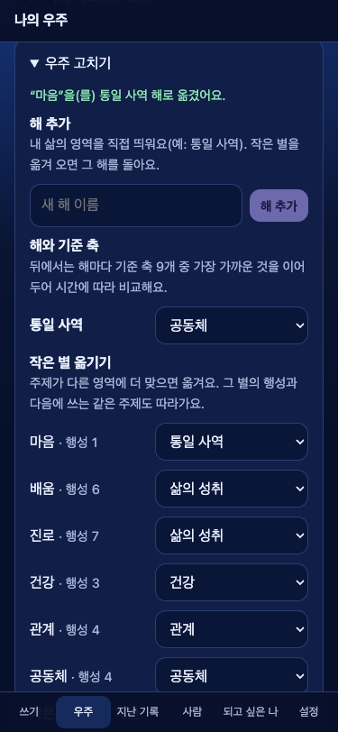 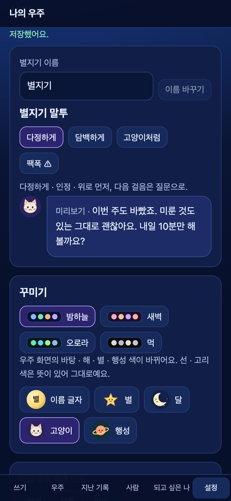 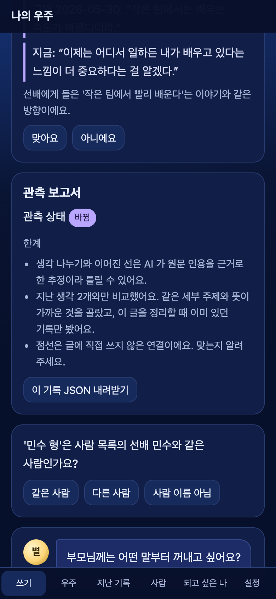

### 1.3 현호가 할 일 (10/17부터)

| 할 일 | 얼마나 | 왜 |
| --- | --- | --- |
| 일기 쓰기(이야기하기 · 직접 쓰기 아무거나) | 하루 5분, 휴대폰이든 PC든 | 실제 사용자 글로만 알 수 있는 것(분류 · 연결 · 말투)이 있다 |
| 점선에 **맞아요 / 아니에요** | 눈에 띌 때 | AI가 추정한 연결(점선)이 맞는지 알려 주는 유일한 정답이다 |
| 요약 확인에서 **맞아요 / 고칠래요** | 대화를 정리할 때 | 대화 정리가 내 말과 맞는지 |
| 한마디에 **좋아요 / 별로**, 마음 버튼 **오늘은 위로만 · 오늘은 살살** | 원할 때 | 말투 · 제안 빈도를 현호에게 맞춘다 |
| 다짐에 **지켰어요 / 그만둘래요** | 해당될 때 | 금빛 고리가 채워지거나 닫힌다 |
| **불편한 점 한 줄** | 불편할 때마다 | 결과 카드 아래와 설정에 있다. 가장 값진 피드백이다. 좋았던 점은 아래 하루 기록지에 |
| **하루 기록지 5칸**(새로) | 쓴 날 · 안 쓴 날 모두 1분 | 아래 표. 적는 곳은 동규가 따로 알려 준다 |
| ~~자기 글 몇 편 빌려주기~~ | **지금은 묻지 않음**(2026-10-13 동규) | Studio 설정 확인 · 정답 붙이기에 현호 글을 쓰지 않는다. 품질은 골든셋 가상 인물로 잰다 |

**하루 기록지 5칸.** 일기 내용은 적지 않는다. 사용성 테스트 참가자도 같은 칸을 쓴다(테스트 날짜는 정하는 중, 2026-10-22 기준).

| 칸 | 예 |
| --- | --- |
| 별지기 질문을 보고 썼나 | 썼다 / 참고만 했다 / 무시했다 + 이유 한 줄 |
| 질문이 답하기 쉬웠나 | 1~3 |
| 쓰는 데 걸린 시간 | 분 |
| 안 쓴 날이면 그 이유 | 바빠서 · 쓸 게 없어서 · 질문이 부담돼서 … |
| 지난 생각과 처음 이어진 날 | 느낌 한 줄 |

**동의 범위(자기 글 빌려주기 — 나중에 다시 물을 때):** 현호가 직접 고른 글만, 고른 용도(설정 확인 · 골든셋)로만 쓴다. 사람 이름은 가명으로 바꿔 쓰고, 발표 · 공유 자료에는 숫자만 싣는다. 언제든 빼 달라고 하면 뺀다. 안 빌려줘도 쓰는 데 아무 문제 없다.

### 1.4 개인정보 약속

현호가 "내 진짜 일기를 써도 되나"를 스스로 정할 수 있게, 지키는 것과 **못 지키는 것**을 함께 적는다.

**어디에 무엇이 저장되나 · 어디로 가나**

| 곳 | 무엇 | 어떤 모양으로 |
| --- | --- | --- |
| Supabase(DB, 서울) | 글 · 생각 · 관계 · 사람 · 한마디 · 피드백 · 설정 · 확인 전 대화 | 원문은 **암호문**, 숫자 · 종류 같은 칸만 평문(아래 '못 지키는 것') |
| Chroma Cloud(벡터, 미국 동부) | 생각마다 숫자 목록(임베딩) 하나 | **가명 글**로 만든 벡터 + id · 날짜 · 생각 종류. 글자는 넣지 않는다 |
| Upstage(Studio · Solar) | 정리 · 대화할 때 보내는 글 | **가명 글**. Studio 입력 파일은 실행이 끝나면 지운다. Upstage 쪽 처리 지역 · 보관 기간은 아직 확인하지 못했다 |
| Upstage 글자 읽기(사진으로 쓸 때만) | 사진 | **이름을 가릴 수 없어 그대로** 간다. 사진은 저장하지 않는다 |
| ElevenLabs(미국, 말로 쓰기 · 읽어 주기를 쓸 때만) | 녹음, 읽어 줄 별지기 말 | **이름을 가릴 수 없어 그대로** 간다. 녹음은 받아쓴 뒤 바로 버린다 |
| 인스타그램 가져오기 | ZIP 파일 | ZIP은 휴대폰 · PC 안에서 푼다. 서버로는 게시물 글 · 시각만 가고, 사진 · 영상은 기기를 떠나지 않는다 |
| 실행 기록(Vercel 로그, 1시간 보관) | 단계 · 시간 · 비용 · 오류 코드 | 원문 · 이름 없음 |

실명 0건 관문은 Studio · Solar로 가는 요청(정리 · 대화)에 건다. 사진 · 받아쓰기 · 읽어 주기는 예외다(2026-10-13 동규 결정 7, 첫 로그인 동의 화면과 개인정보처리방침에 밝힘).

**지키는 것**

| 약속 | 어떻게 지키나 | 코드 |
| --- | --- | --- |
| 일기 원문 · 사람 이름은 **암호화해 저장**한다 | AES-256-GCM. 사용자마다 키가 다르고(마스터 키 + 사용자 id로 만듦), 행마다 묶여 있어 다른 사람 · 다른 행으로 옮기면 풀리지 않는다. 암호화 키는 DB 밖(서버 환경변수 `DIARY_ENC_KEY`)에 있다 | `app/core/security.py`, `app/repository/diary.py` |
| 마음 상태도 암호문 안에 | 위기로 감지된 글인지, 위로 한마디 · 안부 한 줄이었는지, "오늘은 위로만 · 오늘은 살살" 버튼, 말투 설정은 평문 칸에 두지 않는다 | `supabase/migrations/20261009000000_v8_security.sql` |
| **내 글은 나만** | 모든 요청은 로그인 토큰을 확인하고, DB에서도 요청마다 "이 사용자 행만" 규칙(RLS)을 건다. 화면이나 다른 사람이 Supabase에 직접 붙어 표를 읽고 쓰는 길(Data API)은 막았다 | `app/repository/tables.py`, 같은 마이그레이션 |
| **구글 로그인**으로만 들어온다 | 이메일 가입 길은 닫았다. 초대 목록 없이 구글 계정이면 누구나 쓸 수 있다(2026-10-08 동규 결정 — 실제 배포 · 수익화를 생각할 때 정함). 들어온 사람끼리도 서로의 글은 보이지 않는다 | `app/core/auth.py` |
| **외부 AI로는 가명만** 보낸다 | Studio · Solar로 보내기 전에 "민준" → "도윤"처럼 바꾸고, 보내기 직전 사람 목록의 실명이 남았는지 한 번 더 검사한다. 남았으면 보내지 않는다. "김 팀장님 · 은지 집사님"처럼 직함 · 직분이 붙은 이름도 잡는다(10/14 고침) | `app/service/safety/pseudonym.py`, `app/core/llm.py` |
| **실행 기록에 원문이 없다** | 로그 · 오류 메시지 · `/stats` · 운영 화면 숫자에는 글 · 인용 · 이름을 넣지 않는다. 받는 칸을 정해 두고 숫자 · 짧은 코드만 남긴다 | `app/core/logger.py` |
| **처음 로그인할 때 동의를 받는다** | 필수(이용약관 · 개인정보 · 외부 처리와 국외 이전) · 민감정보(따로) · 만 14세 이상, 선택: 운영자가 내 피드백과 그 대상 문장을 읽어도 되는지. 동의 전에는 화면도 백엔드도 기록을 만들지 않는다. 동의 문구가 바뀌면 다시 묻는다 | `/consent`, `app/api/consent.py` |
| **운영자가 볼 수 있는 것은 정해져 있다** | 운영 화면(`/ops`)은 운영자 구글 계정만 연다. 모든 사용자의 숫자 · 코드만 보인다. 피드백 원문 · 대상 문장은 위 선택 동의를 한 사람 것만, 운영자가 '열어 보기'를 누를 때만 열리고(다른 사람 이름은 가명) 열 때마다 열람 기록이 남는다. 동의하지 않은 사람 것은 숫자로만 | `app/api/ops.py` |
| **확인 전 대화는 정리하면 지운다** | 이야기하기의 대화 턴은 사용자별 키로 암호화해 서버에 둔다(다른 기기에서 이어 하기). 요약 확인 · 저장하면 그 대화는 지우고 정리본(기록)만 남긴다. '이 대화 지우기'로 언제든 지운다. 정리했지만 확인하지 않은 초안은 72시간 뒤 지운다 | `app/api/chat.py` |
| **같은 글은 다시 보내지 않는다** | 같은 날 같은 글을 다시 올리면 Studio를 부르지 않고 "이미 정리한 글이에요"로 안내한다. 사용자별 지문(HMAC)으로만 비교해서, 지문으로는 글을 되살릴 수 없다 | `app/repository/diary.py` |
| **사람 한 명 지우기** | 저장된 글 속 그 사람 이름을 관계 말("친구")로 바꾸고 문장 · 생각 · 선은 남긴다. '그 사람이 나온 생각도 지우기'를 고르면 생각 · 관계 · 벡터까지 지운다 | `DELETE /people/{id}`, `/people/{id}/with-thoughts` |
| **기록 하나 지우기** | 그 글의 생각 · 관계 · 한마디 · 피드백 · 벡터까지 지운다 | `DELETE /diary/{id}` |
| **내 기록 내려받기** | 기록 하나 · 전체를 JSON으로 받는다. 내 글이라 다른 사람 이름도 실명 그대로 담긴다(가명 표는 넣지 않음) | `GET /export` |
| **계정을 지우면 다 지운다** | 설정 맨 아래 "계정과 모든 기록 지우기"('지우기'를 직접 입력). 순서: 벡터(Chroma) → DB의 내 행 전부 → 로그인 계정. 벡터를 못 지우면 아무것도 지우지 않고 오류를 보여 준다(계정 그대로, 다시 시도) | `DELETE /me` |
| 위기 글도 다른 글과 똑같이, 가명으로만 보낸다(시험 단계) | 위기 감지는 규칙 → 아니면 **가명 글을 Solar에 한 번 더**(돌려 말한 위기). 대화 · 사진 · 말 · 가져오기도 같은 판정을 거친다. 2026-10-08 동규 결정으로 시험 단계에는 위기로 감지돼도 따로 뜨는 화면 · 상담 단체 연결 없이 평소처럼 기록 · 관측 · 한마디를 거친다. 한마디만 위로로 바꾸고 아래에 안부 한 줄을 붙인다. 감지 결과는 암호문 안에만 남긴다 | `app/service/safety/crisis.py`, `app/agents/graph.py` |

**못 지키는 것(솔직하게)**

- **자동 백업이 없다.** Supabase 무료 판이라 서버 쪽 사고로 기록이 사라지면 되돌릴 수 없다. 소중한 글은 '지난 기록 → 모든 기록 파일로 내려받기(JSON)'로 가끔 받아 둔다.
- **운영자(동규)는 기술적으로 풀 수 있다.** 서버가 글을 풀어야 화면에 보여 줄 수 있어서, 서버 키를 가진 사람은 읽을 수 있는 구조다(종단 간 암호화가 아니다). 직접 동의한 피드백 말고는 읽지 않는 것이 약속이다. DB가 통째로 새어도 키가 없으면 읽히지 않는다는 뜻의 암호화다.
- **가려지지 않는 이름이 있을 수 있다.** 사람 목록에 있는 이름은 항상 가린다. 새 이름은 호칭 · 조사 · "만났다 · 생일" 같은 말을 보고 찾는데, 시험 문장 22개 중 20개를 잡았다. 놓치는 경우: 옛 이름 · 외자 이름, "민혁의 말이…"처럼 행동 말이 없는 문장, '님' 없이 낱말이기도 한 직함 앞의 드문 이름("갑수 대리가"). 같은 사람이 성 붙은 이름과 이름만으로 처음 나오면 두 사람으로 등록된다. 놓친 이름은 실명 그대로 Upstage로 간다. 일기에 자주 나오는 사람은 사람 목록에 미리 넣어 두면 안전하다.
- **사진 · 녹음 · 읽어 주기에는 이름이 그대로 간다**(위 표).
- **Upstage 쪽 처리 지역 · 보관 기간을 아직 모른다**(개인정보처리방침에 '확인 중').
- **평문으로 남는 칸이 있다.** 쓴 날짜 · 마음 날씨 · 처리 상태, 해(삶의 영역) 이름, 생각 종류 · 확신 · 가치, 관계 종류(이어짐 · 긴장 …), 다짐 · 질문의 열림/지킴 상태, 사람의 관계 말(엄마 · 선배), 비용 숫자. DB를 보는 사람은 "언제, 어느 영역에, 어떤 종류의 생각을 썼는지"는 안다. 무엇을 썼는지는 모른다.
- **위기 판정은 Solar가 내려가면 규칙만으로 돌아간다.** 그때는 돌려 말한 위기를 다시 놓칠 수 있다(규칙만으로는 시험 문장 25개 중 2개). 그런 글에는 평소 결과에 안부 한 줄만 붙인다.
- **위기 글이어도 상담 단체로 이어 주지 않는다(시험 단계, 2026-10-08 동규 결정).** 109 · 마들랜 같은 안내나 따로 뜨는 화면은 지금 없다. 정식 운영 때 다시 정한다.
- 가명 글이라도 외부 AI는 글 내용(사건 · 감정)을 읽는다. 가리는 것은 사람 이름뿐이다.
- 사람을 지워도 확인 전 대화 턴 속 이름은 바뀌지 않는다.
- 로그아웃한 로그인 토큰이 최대 60초 더 통한다.

> 가명(pseudonym): 진짜 이름 대신 쓰는 다른 이름. 여기서는 "사람1"이 아니라 "도윤 · 서아"처럼 이름 모양을 쓴다. 그래야 AI가 조사(이/가)를 자연스럽게 붙이고, 돌려받은 뒤 정확히 되돌릴 수 있다.
>
> 암호문 · 평문: 암호문은 키가 있어야 읽히는 글, 평문은 그냥 읽히는 글.

---

## 2. 전체 구조

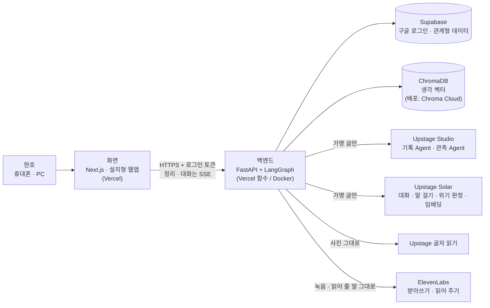

| 부분 | 무엇 | 왜 이걸 골랐나 |
| --- | --- | --- |
| 화면 | Next.js(`infra/frontend`), Vercel 배포, 설치형 웹앱(PWA) | 휴대폰 · PC 둘 다 되는 웹. 스토어 앱 없이 홈 화면에 추가해 쓴다 |
| 백엔드 | FastAPI + LangGraph(`main.py`, `app/`) | 2차 가이드가 요구하는 모양 그대로. 같은 코드를 Vercel 함수와 Docker 둘 다에서 돌린다 |
| 로그인 · DB | Supabase(구글 로그인 + Postgres) | 로그인과 사용자별 데이터 분리를 한곳에서 |
| 벡터 저장 | ChromaDB(로컬 · Docker는 컨테이너, 배포는 Chroma Cloud) | 지난 생각 중 비슷한 것을 찾는 데 쓴다. 저장소를 하나로 줄였다 |
| 기록 · 관측 | Upstage Studio Agent 2개 | 1차 때 만든 에이전트를 그대로 도구로 감싸 부른다 |
| 대화 · 말 걸기 · 판정 · 임베딩 | Upstage Solar(`solar-pro4`, `solar-embedding-2`) | 이야기하기의 답, 한마디, 위기 2단 판정 · 팩폭 넘지 않는 선 판정, 생각을 벡터로 바꾸기 |
| 사진 글자 읽기 | Upstage 글자 읽기(OCR) | 가상 손글씨로 재 보니 글자 읽기(OCR)는 정확도 1.0 · 한 쪽 $0.0015, 문서 읽기(Document Parse)는 줄 공책을 표로 읽어 0.35 · $0.01 |
| 받아쓰기 · 읽어 주기 | ElevenLabs(Scribe · 목소리) | 한국어 받아쓰기 · 목소리 품질(2026-10-13 동규 결정) |
| 자동 검사 | GitHub Actions | push · PR마다 테스트와 골든셋을 돌려 고친 것이 다른 곳을 망가뜨리지 않는지 본다 |

> - SSE(Server-Sent Events): 서버가 한 번의 연결로 진행 상황을 여러 번 밀어 주는 방식. 그래서 화면이 "지금 몇 단계"를 바로 보여 준다.
> - 임베딩(embedding): 문장을 숫자 목록(벡터)으로 바꾼 것. 뜻이 비슷한 문장은 벡터도 가깝다.
> - LangGraph: 여러 단계를 그래프(노드와 화살표)로 잇는 도구. 단계마다 상태를 넘기고, 중간에 끊겨도 이어 하기 쉽다.

**포트:** 로컬 개발(`scripts/start.sh`)은 화면 3000 · 백엔드 8001 · ChromaDB 8000, Docker(`scripts/start_docker.sh`)는 화면 8002 · 백엔드 8001 · ChromaDB 8000. Docker 3개와 로컬 ChromaDB는 `127.0.0.1`(이 컴퓨터)에만 연다. 로컬 Supabase 스택은 그렇게 못 묶어서, 로컬에는 가상 인물 데이터만 넣는다. Docker 3개를 실제 백엔드로 띄워 본 결과는 `docs/docker-verify.md`.

### 2.1 코드 지도

| 경로 | 들어 있는 것 |
| --- | --- |
| `app/core/ontology/v8.json` | 온톨로지 한 파일. 목록 · 정의 · 예시 전부. 모든 코드가 여기서 읽는다 |
| `app/core/config.py` · `llm.py` | 설정(환경변수에서만), Solar 채팅 · 임베딩 클라이언트, 보내기 직전 실명 검사(`guard`) |
| `app/core/auth.py` · `security.py` · `logger.py` · `seed.py` | 로그인 확인 · 허용 목록(설정할 때만) · 계정 지우기, 암호화, 원문 없는 실행 기록, 로컬 시험 계정 · 하늘 데모 |
| `app/service/safety/` | 위기 감지(`crisis.py`, 규칙 + Solar 2단), 가명(`pseudonym.py`), 사람 판정 검사(`judge.py`) |
| `app/service/rules/` | 목록 밖 값(`normalize`) · 주제(`topics`) · 지난 생각 고르기(`past`) · 관계 규칙(`relations`) · 상태(`states`) · 날짜 읽기(`dates`) · 관문(`gate`) · 우주 배치(`view`) |
| `app/service/voice/` | 말 걸기 생성(`__init__.py`)과 생성 뒤 검사(`checks.py`) |
| `app/service/chat/` | 이야기하기: 첫 말 · 답 · 지금까지 정리 · 일기 초안 |
| `app/service/ocr.py` · `stt.py` | 사진 글자 읽기(Upstage), 받아쓰기 · 읽어 주기(ElevenLabs) |
| `app/service/importer/` | 인스타그램 내보내기 읽기(깨진 한글 복원 · 이어 쓴 게시물 묶기 · 제목 속 날짜) |
| `app/service/studio_format.py` | Studio 입력 HTML 만들기 · 출력 읽기 |
| `agent_configs/` | Studio 설정 파일(판마다). 운영은 4판(기록 #5 · 관측 #4) |
| `app/agents/` | 일기 그래프(`graph.py`), 대화 그래프(`chat_graph.py`), Studio 실행(`studio.py`), 도구(`tools.py`) |
| `app/api/` | 일기(`diary` · `write`) · 이야기하기(`chat`) · 사진(`upload`) · 말(`voice_input`) · 가져오기(`importer`) · 우주 고치기(`edit`) · 내려받기(`export`) · 사람(`people_thoughts`) · 동의(`consent`) · 운영(`ops`) |
| `app/repository` · `app/models` · `main.py` | DB 접근 · 입력 스키마 · FastAPI 진입점 |
| `supabase/migrations/` | 7개(처음 표 · RLS, 보안, 기록 칸, 동의, 대화, 운영, 고치기). 모두 덧붙이기만 |
| `infra/frontend/` | 화면. `NEXT_PUBLIC_MOCK=1`이면 백엔드 없이 가짜 데이터로. 가짜 데이터 e2e 28/28, 소개 · 설치 e2e 12/12 |
| `eval/` | 골든셋 191사례(8범주) · 골든셋 밖 측정 문장 84개 · 실행기(`eval/run.py`) |
| `tools/` | Studio 설정 만들기, 분석 품질 · 흔들림 측정(`quality_v3.py` · `stability_v2.py`) |
| `tests/` | 테스트 710개(단위 701 + 로컬 Supabase 통합 9), 단위 701개 전부 통과(10/14) |
| `.github/workflows/` | `test`(push · PR마다 테스트 + 골든셋), `ghcr`(이미지 3개), `health`(매일 운영 확인 — 저장소 변수를 넣으면 켜짐) |
| `Dockerfile` · `docker-compose.yml` · `scripts/` · `vercel.json` | Docker 3개, 실행 스크립트, Vercel 설정 |

1차 파일(`app.py` · `service.py` · `universe.py` · `voice.py` 등 저장소 맨 위)은 Streamlit 데모가 계속 쓰므로 그대로 둔다.

---

## 3. 일기 한 편이 지나가는 길

직접 쓰기 · 사진 · 가져오기는 이 길을 그대로 가고, 이야기하기는 대화를 마칠 때 이 길로 들어온다(3.2).

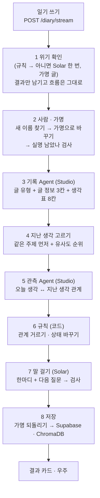

| 단계 | 하는 일 | 왜 있나 | 코드 |
| --- | --- | --- | --- |
| 1 위기 확인 | 자해 · 자살을 떠올리는 말이 있는지 먼저 규칙으로 본다. 규칙이 아니라고 하면 가명 글을 Solar에 한 번 더 묻는다(2단 판정). 위기면 표시만 남기고 흐름은 그대로 간다(시험 단계, 2026-10-08 동규): 7단계에서 한마디를 위로로 바꾸고 안부 한 줄을 붙인다 | 가장 중요한 안전 장치. 규칙은 네트워크 없이 빠르고, 돌려 말한 위기는 Solar가 받친다. 애매하면 위기 쪽으로 | `safety/crisis.py` `detect_crisis(…, llm=True)` |
| 2 사람 · 가명 | 글 속 이름을 찾아 사람 목록에 올리고(헷갈리면 묻기), 가명으로 바꾼다. 보내기 직전 실명 검사 | 외부 AI에 실명이 나가지 않게 | `safety/pseudonym.py` |
| 3 기록 Agent | 글을 HTML로 바꿔 Studio로 보낸다. 글 유형(경험 기록 · 생각·성찰 · 창작 · 기타), 요약 · 말 거는 대상 · 사건, 생각마다 종류 · 확신 · 가치 · 원문 인용 · 주제 · 사람을 받는다 | 자유 글을 정해진 표로 바꿔야 코드가 비교 · 그림을 할 수 있다 | `studio_format.record_html` · `parse_record` |
| 4 지난 생각 고르기 | 오늘 생각과 같은 세부 주제의 지난 생각을 먼저, 나머지는 유사도 순으로 줄 세워 크게 떨어지는 곳에서 자른다(최대 10개). 지금 글보다 먼저 쓴 기록만 후보 | Studio는 한 번에 글 한 장만 본다. 우주 전체를 기억하고 비슷한 과거를 찾는 일은 코드가 한다(RAG의 검색 단계) | `rules/past.py` |
| 5 관측 Agent | 오늘 생각과 고른 지난 생각을 한 장으로 묶어 Studio로 보낸다. 관계(종류 · 근거 인용 · 함께 말하는 대상)와 되고 싶은 모습에 닿은 순간을 받는다 | 두 생각이 어떻게 이어지는지는 판단이 필요해 LLM에 맡긴다 | `studio_format.observe_html` · `parse_observe` |
| 6 규칙 | 관측 결과를 v8 규칙으로 다시 거른다(판단형은 같은 주제 안에서만, 시 · 창작 글에는 관계를 잇지 않음 등). 다짐 · 질문 · 긴장 · 바뀜 상태를 바꾼다 | LLM 판단을 그대로 믿지 않는다. 숫자 문턱 대신 상태로 판정한다 | `rules/relations.py` · `states.py` |
| 7 말 걸기 | 상황(무거운 날 · 늦은 밤 · 기도 · 편지 · 위기 글 …)을 규칙으로 정하고 Solar로 한마디를 만든다. 위기 글이면 위로 + 안부 한 줄. 코드 검사를 통과 못 하면 한 번 다시, 그래도 안 되면 안전한 기본 문장 | 말투는 자유롭게, 넘지 않는 선은 코드로 지킨다 | `service/voice/` |
| 8 저장 | 가명을 실명으로 되돌려 암호문으로 저장(생각 · 관계 · 상태 · 한마디). 생각 벡터(가명 글로 만듦)는 기록 단계에서 ChromaDB에 넣는다 | 다음 글의 "지난 생각"이 된다 | `agents/graph.py` `save`, `repository/diary.py` |

> - RAG(검색 증강 생성): LLM에게 답을 시키기 전에 관련 자료를 먼저 찾아 함께 넣어 주는 방식.
> - 원문 인용을 고치지 않고 받는 이유: 코드가 일기 원문과 글자 대조를 해서(관문 G1) AI가 지어낸 인용을 거른다.

### 3.1 진행 표시(SSE)와 끊겼을 때

화면은 `POST /diary/stream`을 열고 진행 이벤트를 받는다. 일기 한 편은 약 1분(Studio 2번 + Solar 1~2번)이 걸린다. 운영에서 잰 평균은 81초다(10/17).

```text
event: progress
data: {"entry_id": "e1", "step": "record", "label": "생각을 나누는 중", "done": 3, "total": 7}

: keep-alive          ← 약 10초마다. 연결이 끊긴 줄 알고 끊어지지 않게

event: result
data: {결과 전체}
```

- 화면의 단계 이름은 7개다: `safety` → `names` → `record` → `past` → `observe` → `voice` → `save`. 규칙(6단계)은 `observe` 안에서 함께 돈다. 위기 글도 7단계를 다 돈다.
- **끊기면(지하철, 화면 잠금 등):** 이미 끝난 단계는 서버에 암호문으로 남아 있다(`entries.steps_enc`). 화면이 "이어서 하기"를 보여 주고(새로고침해도), 누르면 `POST /diary/{id}/resume/stream`이 **끝난 단계는 건너뛰고** 남은 단계만 한다. 그래서 Studio 비용을 두 번 내지 않는다.
- **같은 글을 다시 올리면** Studio를 부르지 않고 이미 만든 기록으로 안내한다(끝났으면 그 결과, 아니면 이어 하기). 다른 날 같은 글은 새 기록이다.
- 이어 하기 횟수 · 이달 비용 · 하루 글 수 상한은 지금 없다(2026-10-08 동규 결정). 나중에 정해 환경변수(`RESUME_LIMIT` 등)로 넣으면 이어 하기도 처음 쓸 때와 똑같이 본다.
- 같은 기록이 두 번 돌지 않게 DB에 **실행 잠금**(`entries.locked_until`)을 건다. 서버가 여러 대(Vercel)여도 한 대만 잡는다. 서버가 죽으면 잠금은 10분 뒤 풀리고 "멈춤"으로 보인다.
- 같은 내용을 스트림 없이 한 번에 받는 `POST /diary`도 있다(시험 · curl용).

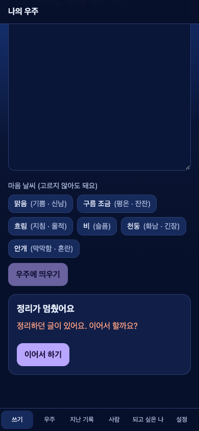

API 전체는 `docs/api-v8.md`. 백엔드가 만드는 `/docs`(OpenAPI)는 로컬에서만 연다(`API_DOCS=1`). 배포에서는 꺼 둔다(주소를 아는 사람에게 API 지도를 보여 주지 않으려고).

### 3.2 이야기하기(대화)가 지나가는 길

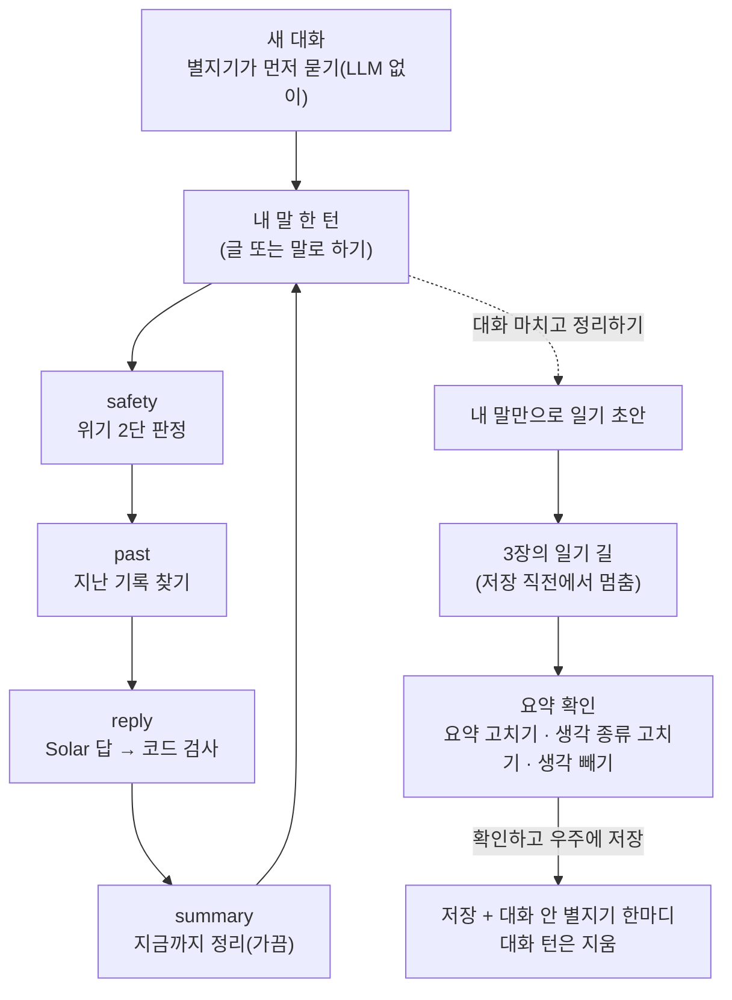

- 턴마다 위기 판정, 가명 처리 · 실명 검사를 거쳐 Solar가 답한다(`app/agents/chat_graph.py`: `safety` → `past` → `reply` → `summary`).
- 지난 기록을 물으면 찾은 기록의 날짜와 원문 인용으로 답한다. 못 찾으면 못 찾았다고 한다(지어내지 않음).
- 300자 넘는 긴 이야기에는 들었다는 한 문장과, 마음이 실린 한 가지만 짧게 이어 묻는다.
- '지금까지 정리'와 일기 초안은 **내 말만** 근거로 만든다(별지기 말은 넣지 않음).
- 요약 확인에서 원문 인용은 고칠 수 없다(G1: AI가 지어낸 인용을 거르는 근거라서). 고친 게 있으면 한마디를 다시 만든다.
- 확인 전 대화는 서버에 암호문으로 두어 다른 기기에서도 이어 한다. 저장하면 대화 턴은 지운다.

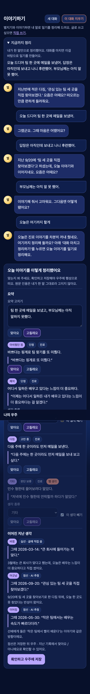

### 3.3 다른 입구: 사진 · 말 · 가져오기

| 입구 | 길 | 지키는 것 |
| --- | --- | --- |
| 사진에서 글자 읽기 | 사진(jpg · png · heic, 여러 장이면 한 편) → 화면이 4MB 아래로 줄임 → Upstage 글자 읽기 → 읽은 글을 쓰기 칸에서 고침 → 3장의 길. 첫 줄 날짜를 읽으면 '글이 다루는 날'이 된다 | 사진은 저장하지 않는다. 정리 요청에는 가명만 |
| 말로 하기 · 녹음 파일 | 마이크 또는 녹음 파일(m4a · mp3 · wav · webm) → ElevenLabs 받아쓰기 → 이야기하기면 대화 턴, 쓰기 화면이면 칸에 채움. 긴 녹음은 화면이 2분 조각으로 나눠 보낸다. 0.5초 미만 · 20분 넘으면 안내 | 녹음은 받아쓴 뒤 바로 버린다. 받아쓴 말도 같은 위기 판정을 거친다 |
| 읽어 주기 | 별지기 말을 ElevenLabs 목소리로 읽는다. 기본 꺼짐, 켜짐 여부는 그 기기에만 남는다 | 읽을 말에는 이름이 그대로 간다 |
| 인스타그램 가져오기 | ZIP을 기기에서 풀어 글 목록 · 예상 시간 · 비용을 먼저 보여 준다 → 전부 / 최근 N편 고르기 → 오래된 것부터 한 편씩 정리. 멈추기 · 이어 하기 | 사진 · 영상은 기기를 떠나지 않는다. 같은 게시물은 다시 정리하지 않는다 |

---

## 4. 온톨로지 요약

> 온톨로지(ontology): 무엇을(대상), 어떤 칸으로(속성), 어떤 값만(정해진 목록) 기록할지 미리 정한 표. 정해 두어야 사람끼리 · 날짜끼리 같은 잣대로 비교할 수 있다.

전부 `app/core/ontology/v8.json` **한 파일**에 있다. Studio 설정 생성기 · 규칙 코드 · 말 걸기 · 화면 범례가 모두 이 파일만 읽는다. 목록을 바꾸면 한 곳만 고치면 된다.

### 4.1 대상 7개

| 대상 | 뜻 | 우주에서 |
| --- | --- | --- |
| 기록 | 일기 한 편 | 행성 |
| 생각 | 기록 속 생각 하나(원문에 가까운 한 문장) | 이어진 선의 끝점 |
| 세부 주제 | 생각이 다루는 구체적인 주제. 사용자별로 다시 씀 | 작은 별 |
| 삶의 영역 | 삶을 나누는 큰 영역. 뒤에 기준 축 9개를 이어 둠 | 해 |
| 관계 | 생각과 생각 사이의 이어짐 | 이어진 선 |
| 사람 | 생각에 나오는 사람(실명 보관, 밖으로 나갈 때만 가림) | 고르면 그 사람이 나온 행성이 빛남 |
| 되고 싶은 모습 | 사용자가 스스로 말한 되고 싶은 나 | 북극성 |

### 4.2 글 정보 3칸 · 생각 8칸

| 글 정보 | 값 |
| --- | --- |
| 요약 | 1~2문장, 사람을 평가하지 않음 |
| 말 거는 대상 | 나 / 특정 인물(편지) / 신(기도) |
| 사건 | 있었던 일, 사실만 |

| 생각 칸 | 값 |
| --- | --- |
| 생각 | 원문에 가까운 한 문장 |
| 종류 | 아래 9개 |
| 확신 | 단정 / 고민 중 / 판단 보류 |
| 가치 | Schwartz 10개(자율 · 도전 · 즐거움 · 성취 · 영향력 · 안정 · 규범 · 전통·신앙 · 배려 · 공익), 드러나지 않으면 비움 |
| 원문 인용 | 근거 문장, 글자 그대로 |
| 스스로 쓴 변화 | "예전 → 지금"을 직접 쓴 경우만 |
| 주제 | 해 이름보다 한 단계 구체적. 기존 작은 별 이름은 같은 일 · 같은 대상일 때만 다시 쓴다 |
| 사람 | 사람 목록의 이름(외부 AI에는 가명) |

**기록에 붙는 칸(10/14 더함):** 출처(대화 · 텍스트 · 사진 · 지난 글 묶음), 글이 다루는 날(확실 · 추정, 날짜처럼 보이는데 못 읽으면 '날짜 확인 필요'), 확인(대화만: 확인 전 · 확인됨), 글 유형(경험 기록 · 생각·성찰 · 창작 · 기타).

### 4.3 생각의 종류 9개

| 종류 | 뜻 | 예(가상) |
| --- | --- | --- |
| 해석 | 무언가의 의미를 읽어 냄 | 팀장님이 말을 아낀 건 내 발표를 기다려 준 거였던 것 같다. |
| 신념·원칙 | 일반적인 주장을 세움 | 약속 시간은 상대의 하루를 지키는 일이다. |
| 질문 | 답을 못 낸 물음(물음표 없어도) | 지금 휴학하는 게 도망일까, 쉼일까? |
| 다짐 | 앞으로 하겠다고 스스로 약속 | 이번 주부터 자기 전에 휴대폰을 거실에 두고 자겠다. |
| 소망 | 바라지만 약속하지는 않음 | 엄마 수술이 무사히 끝났으면 좋겠다. |
| 자기평가(부정) · 화면 "아쉬웠던 점" | 기준에 비춰 나를 낮게 평가 | 오늘도 운동을 미뤘다. 핑계만 늘었다. |
| 자기평가(긍정) · 화면 "잘한 일" | 기준에 비춰 나를 인정 | 떨렸지만 질문까지 끝까지 답했다. 나 좀 잘했다. |
| 감정(고마움이면 "감사" 표시) | 평가 없이 마음 상태만 | 비가 와서인지 하루 종일 마음이 가라앉았다. |
| 기타(원래 말 함께 저장) | 어디에도 안 맞음 | 오늘 일기는 여기까지. |

**목록 밖 값 규칙(모든 닫힌 목록 공통):** 뜻이 하나면 바로잡는다("확실함" → 단정). 애매하면 "기타 + AI가 쓴 원래 말". 자주 나오는 원래 말은 새 값 후보로 올리고 사람이 정한다. (`app/service/rules/normalize.py`)

### 4.4 관계 6개

| 관계 | 묶음 | 뜻 | 규칙 |
| --- | --- | --- | --- |
| 이어짐 | 영향형 · 보라 | 같은 방향의 생각이 다시 나옴(지켜진 다짐 포함) | 근거가 있으면 영역을 넘음 |
| 바뀜 | 판단형 · 보라 | 신념 · 해석이 반대가 되거나 기준이 달라짐 | 같은 주제 안에서만. 감정끼리는 아님 |
| 긴장 | 영향형 · 주황 | 둘 다 열려 있는 맞서는 두 생각(쌍행성) | 근거가 있으면 영역을 넘음 |
| 해소 | 판단형 · 보라 | 긴장 · 열린 질문이 결론으로 정리됨 | 같은 주제 안에서만 |
| 어긋남 | 판단형 · 주황 | 열린 다짐 뒤에 같은 주제의 아쉬웠던 점 | 같은 주제 안에서만. 다짐은 닫지 않고 "실수" 표시 |
| 목표 충돌 | 영향형 · 주황 | 진행 중인 두 다짐이 시간 · 에너지를 다툼 | 영역을 넘어도 됨 |

- **선:** 실선 = 원문으로 확인(글쓴이가 직접 쓴 변화, 또는 사용자가 "맞아요"). 점선 = AI 추정. 점선에는 모두 "맞아요 / 아니에요" 단추가 붙는다(`needs_confirm`).
- **같은 두 생각 사이 관계는 하나.** 겹치면 해소 > 바뀜 > 어긋남 > 목표 충돌 > 긴장 > 이어짐.
- **주제 이름이 같아도 같은 일이 아니면 잇지 않는다.** 시 · 창작 글에는 관계를 잇지 않는다(4판, 코드로도 거름).
- **영역을 넘는 선:** 같은 글이면 "그래도 · 그래서"처럼 이어 쓴 흐름 + 원문 인용이 있을 때, 다른 날이면 원문 설명이 있을 때만 점선으로. 화면에서는 기본으로 행성을 눌렀을 때만 보인다(설정에서 숨김 · 항상으로 바꿈).

### 4.5 상태

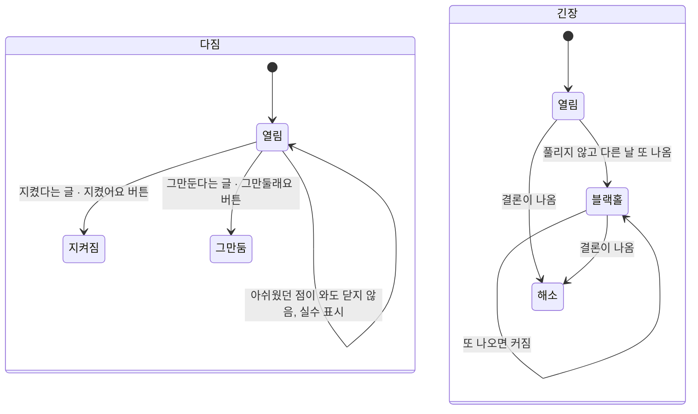

| 상태를 갖는 것 | 상태 | 바뀌는 때 |
| --- | --- | --- |
| 다짐 | 열림 → 지켜짐 · 그만둠 | 글 또는 버튼. 기한이 지나도 저절로 닫지 않고 별지기가 안부를 묻는 재료가 된다 |
| 질문 | 열림 → 해소 | 같은 주제에서 단정한 생각이 나옴 |
| 긴장 | 열림 → 해소 · 블랙홀 | 결론이면 해소, 다시 나오면 블랙홀(오래 머문 고민) |
| 바뀜 | 후보 → 확정 | 직접 쓴 변화면 바로 확정, 아니면 다른 날 다시 나오거나 "맞아요"면 확정 |

### 4.6 우주 기호

| 기호 | 뜻 |
| --- | --- |
| 해 | 삶의 영역. 크기 = 기록 수. 일기에 나온 영역 + 내가 추가한 해만 뜬다. 가운데에는 다른 해와 이어진 선이 많은 해가 온다 |
| 작은 별 | 세부 주제 |
| 행성 | 일기 한 편. 작은 별에 가까울수록 먼저 쓴 기록 |
| 실선 / 점선 | 원문 확인 / AI 추정 |
| 쌍행성 | 긴장 |
| 블랙홀 | 오래 머문 고민. 다시 나올수록 커짐 |
| 금빛 고리 | 다짐. 지키면 채워짐 |
| ? | 아직 답을 못 낸 질문 |
| 북극성 | 되고 싶은 모습. 누르면 닿은 순간이 있는 행성이 빛남 |
| 색 | 보라 = 이어지는 관계, 주황 = 충돌. 테마를 바꿔도 선 · 고리 · 북극성 · 블랙홀처럼 뜻이 있는 색은 그대로다 |

마음 날씨(사용자가 고름, 안 골라도 됨): 맑음(기쁨 · 신남) · 구름 조금(평온 · 잔잔) · 흐림(지침 · 울적) · 비(슬픔) · 천둥(화남 · 긴장) · 안개(막막함 · 혼란). 비 · 천둥이면 제안 없이 위로만.

### 4.7 왜 이렇게 나눴나

| 결정 | 이유 |
| --- | --- |
| 닫힌 목록은 연구 척도에서 | 삶의 영역 9 = PWI · WHOQOL(안녕감 · 삶의 질 척도), 가치 10 = Schwartz 기본 가치. 검증된 틀이라 사람끼리 비교가 된다 |
| 확신은 3단계만 | 5단계면 사람끼리도 일치도가 낮다(Rubin 2007). "정말 · 진짜" 같은 강조어로 단정을 매기지 않는다 |
| 소망 · 자기평가 추가 | 바람(소망)과 약속(다짐)은 다르다(Gollwitzer 1999). 반성만 있으면 "잘한 일"을 담을 곳이 없다 |
| 숫자 기준(7 · 14 · 30일, 유사도 0.75 등) 삭제 | 그 숫자를 주는 연구를 찾지 못했다. "아직 열려 있는가"(상태)와 순위로 바꿨다. 남은 숫자는 비용을 지키는 운영 한도뿐 |
| 소제목 단위("부분") · 계기 · 기간 · 참고 삭제 | "이 칸을 지우면 무엇이 안 되나?"에 답이 없었다. 칸 하나마다 AI 지시 · 검사 · 화면이 같이 늘어난다 |
| 해는 혼합형 | 처음 화면이 "빈 해 9개"면 어색하다. 일기에 나온 영역만 띄우고, 뒤에서 기준 축 9개에 이어 둬 비교는 유지. 내가 해를 추가하면 AI가 가까운 기준 축을 제안하고 내가 바꾼다 |
| 영역을 넘는 선은 엄격하게 | 영역 사이 영향은 실재하지만 같은 영역 안보다 약하고 사람마다 다르다. 그래서 근거를 엄격히 보고, 기본으로 눌렀을 때만 보인다 |

근거 원문: PRD v8 §4(vault `projects/talking-diary/나의-우주-PRD-v8.md`), 결정 기록 1~15(vault `system/ontology/decisions/2026-10-07-talking-diary-ontology-revision.md`).

---

## 5. 에이전트

### 5.1 Studio 기록 Agent · 관측 Agent

두 에이전트 모두 **Parse → Classify → Extract** 세 노드다. Parse가 글을 읽고, Classify가 갈래를 고르고, Extract가 정해진 표(스키마)를 채운다. Classify · Extract 단계는 Upstage 전용 모델만 쓴다(고르는 칸이 없다).

| | 기록 Agent | 관측 Agent |
| --- | --- | --- |
| 입력 | 오늘 글 한 편(가명, HTML) + 기존 작은 별 이름 목록 | 오늘 생각 T1 … + 고른 지난 생각 P1 …(날짜 · 주제 · 해 · 종류 · 인용) + 되고 싶은 모습 |
| Classify | 글 유형 4갈래: 경험 기록 · 생각·성찰 · 창작 · 기타 | 관측 상태 6갈래: 처음 쓰는 주제 · 이어짐 · 바뀜 · 긴장 · 해소 · 어긋남 |
| Extract | 글 정보 3칸 + 생각 표 8칸 | 관계 표(종류 · 근거 인용 · 함께 말하는 대상 …) + 닿은 순간 표 |
| 운영 설정 | **#5**(4판) | **#4**(4판) |

**설정을 코드로 만든다:** `tools/studio_make_configs.py`가 `v8.json`에서 설정 파일(`agent_configs/`)을 만들고, Studio에서 가져와(Import) 견본으로 돌려 번호를 확정한다. 설정이 파일로 남아야 비교 · 되돌리기 · 재현이 된다. 서비스는 번호를 환경변수(`V8_RECORD_CONFIG_ID=5` · `V8_OBSERVE_CONFIG_ID=4`)로 고정해 부르므로, 누가 Studio에서 설정을 고쳐도 결과가 갑자기 바뀌지 않는다. (1판 "1"은 Streamlit 데모가 계속 쓴다.)

**판마다 바뀐 것**
- 1판 → 2판(10/8): 글 정보 7칸 → 3칸, 생각 7칸 → 8칸(사람 칸), 종류 6 → 9(정의와 경계 문장까지), 가치는 Schwartz 뜻풀이, 주제는 해 이름 금지 · 기존 작은 별 이름 재사용, 관측은 "두 생각이 같은 대상을 직접 말할 때만 관계" + 되고 싶은 모습에 닿은 순간 찾기.
- 2판 → 4판(10/14, 지금 운영): 시 · 창작 글에는 관계를 잇지 않기, 사건 서술은 생각에 넣지 않기, 가치 이름을 주제로 쓰지 않기, **기존 작은 별 이름은 같은 일 · 같은 대상일 때만 다시 쓰기**(기록 #5), **주제 이름이 같아도 같은 일이 아니면 잇지 않기**(관측 #4). 코드도 시 · 창작 글에 닿는 관계를 버리고, 쉼표로 여럿 쓴 주제를 하나로 줄인다.

**가상 인물 하늘의 글 29편을 서비스와 같은 길로 돌려 잰 화면 거짓 연결**(화면에 보이는 관계 중 약하거나 틀린 비율, Claude 판정):

| 판(기록 / 관측) | 화면 거짓 연결 | 판정 |
| --- | --- | --- |
| 2판(#2 / #2) | 0.57 | 10/14 오전까지 운영 |
| 3판 A(#3 / #3) | 0.71 | 안 씀(작은 별을 엉뚱한 일에 다시 붙임) |
| **4판(#5 / #4)** | **0.27 · 0.44, 두 번 평균 약 0.36** | **운영 전환** |
| 4b(#6 / #4) | 0.42 | 안 씀 |

거짓 연결은 크게 줄었지만 화면 관계 셋 중 하나쯤은 아직 약하거나 틀리다. 같은 설정도 실행마다 ±0.1쯤 흔들린다. 그래서 다른 날 사이 관계는 점선으로 두어 현호의 "맞아요 / 아니에요"를 기다리고, **같은 글을 다시 정리해도 같은 결과가 나오게 하는 일**(분석 일관성)이 다음 개발 과제다(8.3). 자세한 측정은 `docs/eval-v8.md`의 품질 3판 · 4판 절.

### 5.2 Solar 말 걸기 (별지기)

**말투 5종** (설정에서 고름, 팩폭은 "거친 말이 나와요" 경고 확인 뒤에만, 직접 정하기는 2026-10-28). 한마디와 이야기하기 답에 같은 말투와 같은 넘지 않는 선이 걸린다.

| 말투 | 모양 |
| --- | --- |
| 다정하게 | 인정 · 위로 먼저, 다음 걸음은 질문으로 |
| 담백하게 | 짧게, 사실 위주 |
| 고양이처럼 | 새침데기 고양이(2026-10-28): 관심 없는 척 툭 던지지만 슬쩍 챙겨 줌. 몸짓 말 · '냥'은 가끔(냥은 한마디에 한 번까지, 검사가 막음), 무거운 날엔 새침함 없이 위로 |
| 팩폭 | 세게. 반말 · 명령형 · 거친 표현 허용. 기록의 숫자로 때리고 핑계를 짚는다 |
| 직접 정하기 | 사용자가 적은 말투 바람(설정 `tone_note`, 200자 안)을 프롬프트의 `[사용자가 원한 말투]` 절에 넣는다(가명 처리). 말하는 방식만 바꾸고, 그 뒤의 `[지킬 것]` · 상황 · 답 형식 절이 늘 이긴다고 적는다. 위기 글 · 무거운 날엔 바람을 빼고 다정하게(위기 글은 팩폭처럼 그 글만 다정하게). 바람을 쓴 말은 팩폭처럼 넘지 않는 선을 Solar 로 한 번 더 판정 |

**넘지 않는 선(말투와 상관없이):**
1. 위기 신호면 그 글은 위로로 낮춘다(팩폭도 그 글만 다정하게, 제안 · 거친 표현 없이). 힘든 마음은 알아주되 죽음 · 사라짐 바람은 따라 말하지 않는다. 시험 단계(2026-10-08 동규)에는 상담 단체 · 전화 안내 없이 한마디 아래에 **안부 한 줄**(코드에 둔 고정 문장, 말투별 2~3개 중 지난 안부와 겹치지 않는 것)만 붙인다. 위기 2차 판정(Solar)이 실패한 글도 평소 한마디에 같은 안부 한 줄.
2. 때리는 대상은 행동 · 핑계 · 미루기뿐. 사람의 가치 · 외모 · 가족 · 정체성은 공격하지 않는다("핑계 그만"은 되고, "넌 글렀어"는 안 됨).
3. 어쩔 수 없는 일(아픔 · 상실 · 남이 한 일)은 팩폭 대상이 아니다.
4. "오늘은 살살"을 누르면 그날만 낮춘다.
5. 모든 말투: 원문 근거, 지난 한마디와 반복 금지, 사람 판정 금지, 설교 금지.

**상황:** 코드가 먼저 정한다(LLM 아님). 무거운 날(비 · 천둥 · 슬픔 · 위기 글) → 제안 없이 위로만. 늦은 밤 길게 → 쉬게. 기도 → 평가 없이 짧게 받기. 편지 → 그 사람과의 지난 기록을 이어 비추기. 다짐 안부, 다짐을 지켜 냄, 되고 싶은 모습에 닿음. 이야기하기에서 긴 이야기 → 들었다는 한 문장 + 한 가지만 이어 묻기.

**검사(코드):** 만든 말을 `voice/checks.py`가 본다. 사람 판정 · 인격 · 외모 · 가족 · 정체성 공격, 위기 방법 · 장소, 단체 이름 · 전화번호(109 · 마들랜 …), 위기 글이면 기관 안내(상담 · 병원 …)와 죽음 · 사라짐 바람을 되받는 말, 거리 숫자(점수 · 달성률), 원문에 없는 따옴표 인용, 지난 한마디와 반복, 무거운 날의 제안, 300자 초과. 걸리면 한 번 다시 만들고, 또 걸리면 안전한 기본 문장을 쓴다.

**예시(가상 인물 서윤, `docs/voice-examples.md`에서):**

| 글 | 말투 | 한마디 |
| --- | --- | --- |
| 다짐을 또 미룬 날 | 팩폭 | 야, 달릴 체력이 없는 게 아니라 침대에서 유튜브 두 시간 동안 안 일어난 거야. 이번 주만 세 번째 미뤘고 '피곤해서'만 반복하네. 진짜 하고 싶으면 내일 아침에 신발부터 신어. 그거부터 해. |
| 비 오는 날(상실) | 팩폭 | 한 달째 밥그릇도 못 치우고 간식 코너 앞에서 한참 섰다는 거, 그게 오늘 네 하루야. … 비 오는 날이니 더 밀어붙이지 않을게. 그냥 그 자리에 있어도 돼. |
| 기도 | 다정하게 | 내일 첫 발표, 준비는 이미 해 두셨네요. 손이 떨려도 끝까지 말하고 싶은 마음이 그대로 읽혀요. … |

같은 팩폭이라도 미룬 날에는 세게, 상실의 날에는 때리지 않고 위로만 한다. 4차 실행 25건에서 인격 공격 · 사람 판정 · 거리 숫자는 0건이었다.

### 5.3 LangGraph 그래프 (2차 가이드와 맞추기)

2차 가이드의 필수 산출물(State · Tools · 하위 그래프 · Super Graph + SSE)을 그대로 따른다. 가이드 예시(HR 서비스)의 파일 이름 · Streamlit은 따르지 않고 우리 기능으로 바꿨다.

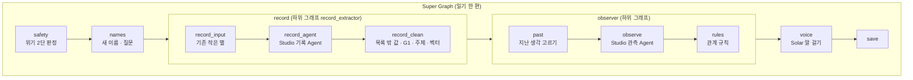

일기 그래프는 `app/agents/graph.py`, 대화 그래프는 `app/agents/chat_graph.py`(턴마다 `safety` → `past` → `reply` → `summary`)다. 위기 글도 같은 길을 간다(시험 단계): `safety`는 위기 여부만 State에 남기고, `voice`가 위로 한마디 + 안부 한 줄을 만들고, `save`가 위기 표시를 암호문 안에 남긴다.

| 가이드 요구 | 나의 우주 |
| --- | --- |
| State | `State`(TypedDict): `user_id` · `entry_id` · `title` · `text` · `written_at` · `day` · `weather`, `done`(끝난 노드), `crisis` · `crisis_unsure`(위기 2차 판정 실패), `people`(사람 목록 = 가명 표), `questions`(헷갈리는 이름 질문), `topics`(기존 작은 별), `record_raw` · `record`(글 정보), `today`(오늘 생각), `dropped_quotes`, `past`(고른 지난 생각), `observed`(관측 결과), `relations`(규칙을 거친 관계), `reached`(닿은 순간), `voice`(한마디) |
| Tools | `app/agents/tools.py`: `run_record_agent` · `run_observe_agent`(Studio, `studio.py`가 1차 에이전트를 그대로 부름) · `search_past` · `embed` · `speak`(Solar). 모두 보내기 전에 가명, 받은 뒤 되돌림 |
| 하위 그래프 | `record_extractor` = `record_input` → `record_agent` → `record_clean`, `observer` = `past` → `observe` → `rules` |
| Super Graph | `safety` → `names` → `record` → `observer` → `voice` → `save`. 노드마다 실명 검사 guard 안에서 돌고, 끝나면 SSE 진행 이벤트 · 원문 없는 실행 기록 · 단계 저장 |
| 대화 그래프 | `TalkState`: `safety` → `past` → `reply` → `summary`(턴마다). '대화 마치고 정리하기'는 내 말로 만든 초안을 Super Graph에 넣고 `save` 앞에서 멈춘다(요약 확인) |
| 스트리밍 API | `POST /diary/stream` · `POST /talk/{id}/turn/stream`, keep-alive 약 10초 |
| 이어 하기 | 노드가 끝날 때마다 State를 암호화해 `entries.steps_enc`에 저장. 다시 돌리면 `done`에 있는 노드는 건너뛴다 |

화면의 진행 단계 7개(`safety` · `names` · `record` · `past` · `observe` · `voice` · `save`)는 이 노드 이름에서 왔다. `rules`는 `observe` 단계 안에서 함께 돈다.

---

## 6. 안전 장치

| 장치 | 무엇을 막나 | 어떻게 | 코드 · 시험 |
| --- | --- | --- | --- |
| 위기 대응(시험 단계) | 위험한 순간에 평소 같은 팩폭 · 제안, 놀라게 하는 말 | 1단 규칙: 강한 신호 하나 또는 약한 신호 둘 이상이면 위기. "배고파 죽겠다" 같은 관용 표현과 뉴스 · 영화 · 노래 이야기는 거른다. 2단: 규칙이 아니라고 하면 가명 글을 Solar에 한 번 묻는다(애매하면 위기, 글 하나에 0~1번, 약 1초 · $0.0005). 2026-10-08 동규 결정(시험 단계): 위기여도 평소 결과를 그대로 만들고, 따로 뜨는 화면 · 단체 안내(109 · 마들랜 · 119 · 112)는 없다. 그 글의 한마디만 위로(제안 없음, 팩폭은 다정하게)로 바꾸고 아래에 안부 한 줄. 사람 판정 · 방법 · 장소 · 단체 · 번호 · 위기 바람 되받기는 코드가 막는다. 코드 검사를 지난 위기 글 한마디는 Solar가 위기 바람에 동조로 읽히는지 한 번 더 판정한다. 이야기하기 턴 · 받아쓴 말 · 사진에서 읽은 글 · 가져온 글도 같은 판정을 거친다 | `safety/crisis.py`, `voice/__init__.py`(`CHECK_IN` · `CRISIS_SAFE`), `voice/checks.py`(`llm_crisis_problems`), `tests/test_safety_crisis.py` · `test_voice_generate.py` · `test_graph_flow.py` |
| 가명 처리 | 외부 AI에 실명 노출 | 사람 목록 + 새 이름 찾기(호칭 · 조사: "민준이가 · 지은 선배 · 수빈과", 직함 · 직분: "김 팀장님 · 은지 집사님", 영문 이름, 조사 없이 "철수 만났다") → 받침이 같은 가명으로 바꿈(조사가 그대로 맞게) → 확실하지 않으면 가명 쪽으로. 낱말이 사람으로 자동 등록되지는 않게 "이름인지 낱말인지" 질문으로 돌린다 | `safety/pseudonym.py` |
| 왕복 검사 | 가명이 빠지거나 잘못 되돌려짐 | 보내기 직전 `assert_no_real_names`로 요청 전체(글 · 칸 · 목록)에 실명이 하나라도 있으면 보내지 않는다. 받은 뒤 `unmask`로 되돌린다. 시험은 "실명이 외부 요청에 0건"과 "가리고 되돌리면 원래 글" | `tests/test_safety_pseudonym.py` |
| 헷갈리는 이름은 묻기 | 동명이인 · 별명 · "하늘 · 봄"처럼 이름인지 낱말인지 | 결과 카드에 질문으로 띄우고, 답하기 전에는 가명으로 보낸다 | `pseudonym.find_new_names` |
| 암호화 | DB가 새도 일기 · 이름이 읽히지 않게 | AES-256-GCM, 사용자 키 = HKDF(마스터 키, 사용자 id), 행마다 새 nonce, 행 주소(`표:id`)에 묶음. 암호문: 제목 · 본문 · 요약 · 사건, 생각 · 인용 · 스스로 쓴 변화 · 주제, 작은 별 이름, 사람 이름 · 별명, 관계 설명 · 근거, 상태 이력, 한마디 · 다음 질문 · 안부 한 줄 · 위로 여부, 되고 싶은 모습, 확인 전 대화 턴, 불편한 점 한 줄 · 마음 상태 버튼, 설정, 위기 표시, 끊긴 기록의 단계 저장값 | `core/security.py`, `repository/diary.py`, `tests/test_core_security.py` |
| Data API 막기 | 화면에 공개된 anon 키 + 내 토큰으로 Supabase 표를 직접 고치기(비용 기록 지우기 등) | 마이그레이션이 anon · authenticated의 표 권한을 모두 거둔다. 백엔드는 Supabase API가 모르는 역할 `app_user`로 붙고, RLS도 그 역할에 건다. 비용 기록은 음수를 막는다(check) | `20261009000000_v8_security.sql`, `tests/test_repo_pg.py` |
| 사진 · 녹음 저장 안 함 | 가릴 수 없는 원본이 남는 것 | 사진 · 녹음은 요청 메모리에서 Upstage · ElevenLabs로 보내고 버린다(DB · 디스크 · 로그 0) | `api/upload.py`, `service/stt.py` |
| 운영 화면 열람 기록 | 운영자가 몰래 읽는 것 | 피드백 원문은 선택 동의한 사람 것만, 누를 때만, 볼 때마다 사용자별 열람 기록 | `api/ops.py` |
| 허용 목록(지금은 끔) | 주소를 아는 아무나 가입해 비용을 쓰는 것 | 지금은 막지 않는다: 구글 로그인한 누구나 쓴다(2026-10-08 동규 결정). 손잡이 `ALLOWED_EMAILS`에 이메일을 넣으면 목록 밖 계정은 403 | `core/auth.py`, `tests/test_api_security.py` |
| 실행 잠금 · 상한 | 같은 기록이 두 번 돌아 비용이 두 배, (상한을 켜면) 한 사람이 비용을 끝없이 키움 | DB 조건부 update로 잠금 하나만 잡음. 글 8000자 · 제목 120자. 사용자별 운영 상한(`DAILY_ENTRY_LIMIT` · `MONTHLY_COST_CAP_USD` · `RESUME_LIMIT`)은 지금 없음(기본 0). 환경변수로 값을 넣으면 건다 | `api/diary.py`, `repository/diary.py` |
| Studio 파일 지우기 | 가명 일기 HTML이 Upstage Files에 남는 것 | 실행이 끝나면(성공 · 실패 · 시간 초과 모두) 올린 입력 파일을 지운다 | `agents/studio.py` |
| 원문 없는 로그 | 로그 · 오류 · 통계로 원문이 새는 것 | 받는 칸을 정해 두고(단계 · 시간 · 호출 수 · 추정 비용 · id · 오류 코드 · 개수), 글자 값은 40자에서 자른다. 상황 이름("무거운 날") · 위기 여부 · 위로 모드도 남기지 않는다. 오류는 예외 종류 이름만 | `core/logger.py` |
| 계정 · 기록 지우기 | 지운 뒤에도 벡터 · 행이 남는 것 | `DELETE /diary/{id}`(생각 · 관계 · 한마디 · 피드백 · 벡터까지), `DELETE /me`(벡터 → DB → 로그인 계정 순서, 벡터 실패면 멈춤) | `api/routes.py`, `tests/test_api_security.py` |
| 팩폭의 넘지 않는 선 | 말이 사람을 다치게 하는 것 | 프롬프트 규칙 + 생성 뒤 코드 검사 + 실패 시 기본 문장(5.2) | `voice/checks.py`, `tests/test_voice_generate.py` |
| 사람 판정 금지 | "너는 ~한 사람이다", 진단명 | 판정 · 진단 표현 목록으로 검사 | `safety/judge.py` |

### 6.1 관문 (PRD §8.2, 모든 실행에서 0건이어야 함)

| 관문 | 무엇 | 처리 |
| --- | --- | --- |
| G1 | 원문에 없는 인용 | 그 생각 하나만 저장하지 않는다 |
| G2 | 제목 · 첫 줄에 날짜가 있는데 못 읽음 | "날짜 확인 필요" 표시 → 사용자가 날짜를 골라 고친다 |
| G3 | 사람을 단정 · 진단하는 말 | 중립 문장으로 바꾸거나 다시 만든다 |
| G4 | 다른 사람 실명 노출 | 저장은 실명, **밖으로 나가는 것**(외부 AI · 공유 · 평가 데이터 · 실행 기록 · 발표)에서만 가림. Studio · Solar 요청에서 0건. 사진 글자 읽기 · 받아쓰기 · 읽어 주기와 내 JSON 내려받기는 예외 |

한계도 적어 둔다: 이름 · 공격 표현 검사는 낱말 · 꼴 규칙이라 처음 보는 돌려 말하기나 드문 이름은 놓칠 수 있다. 그래서 위기는 규칙 + Solar 2단으로 "놓치지 않는 쪽", 이름은 "확실하지 않으면 가명 쪽"으로 기울였다. 팩폭 한마디는 코드 검사 뒤 Solar가 넘지 않는 선을 한 번 더 판정한다. 새는 사례는 골든셋에 모아 규칙을 보강한다.

---

## 7. 운영(Ops)

방향: **사용자 맞춤 중심 + 작은 안전망.** 품질은 주로 현호의 피드백으로 현호에게 맞춰 가며 올린다. 정답 세트(골든셋)는 "망가졌는지 보는 안전망"으로만 쓴다.

### 7.1 골든셋

> 골든셋(golden set): 기대 결과를 미리 붙여 둔 시험 사례 묶음. 설정 · 규칙을 바꿀 때마다 돌려 망가진 곳이 없는지 본다.

- 위치: `eval/golden/*.json`, 실행기 `eval/run.py`, 결과 `eval/results/`, 설명 · 최신 숫자 `docs/eval-v8.md`.
- 가상 인물 7명(`personas.json`, 대학생 · 직장인 · 육아 중인 부모 · 기도 일기 교사 · 꽃집 주인 · 프리랜서 · 텃밭지기)의 지어낸 글로 만들었다. 사례마다 기대 결과, 판정 방식(코드 / Solar 채점), 근거, 애매 표시가 있다.

| 범주 | 사례 | 무엇을 |
| --- | --- | --- |
| safety_pseudonym | 24 | 외부로 가는 글에 실명 0건, 가리고 되돌리면 원문, 이름 같은 낱말 · 동명이인 |
| crisis | 32 | 위기 글을 잡는가(관문) + 시험 단계 방침(위로 · 안부 한 줄 · 단체 · 번호 없음), 관용 표현 · 남 이야기는 아님 |
| fact_bomb | 28 | 선 넘는 팩폭을 그물이 막는가, 위기면 팩폭이어도 그 글만 다정한 위로 + 안부 한 줄 |
| voice_safety | 24 | 무거운 날 위로만, 기도 · 편지, 사람 판정 · 거리 숫자 막기 |
| conversation(새로) | 35 | 이야기하기: 상황별 첫 말, 지난 기록 인용이 실제로 있는가, 못 찾으면 못 찾았다고, 위기 턴 |
| relations | 14 | 관계 규칙 · 상태 |
| classify | 21 | 목록 밖 값 · 주제 · 감사 표시 |
| cross_domain | 13 | 영역을 넘는 선의 조건 |
| **합계** | **191** | |

- **관문(배포 가능 조건) = 100%:** 실명 가리기 전부, 위기 쪽 전부(감지 + 시험 단계 방침), 선 넘는 팩폭 · 위기 글 위로 전환 · 살살, 사람 판정 · 진단, 대화의 지어낸 인용 · 위기 턴. 하나라도 실패하면 배포하지 않는다. 10/14 합친 판에서 외부 호출 없는 모드로 관문 사례 전부 통과, 회귀 0. 이야기하기 범주는 기계 판정 29/29.
- **골든셋 밖 문장(일반화 측정, 규칙 · 프롬프트에 넣지 않은 새 문장):**
  - 위기 42문장(위기 25 · 아님 17): 규칙만 **2/25** → 규칙 + Solar **25/25**, 위기 아님 오탐 0/17.
  - 이름 42문장(이름 있음 22 · 낱말만 20): 이름 잡기 **5/22 → 20/22**, 낱말이 사람으로 자동 등록 5 → **0**.
- 정답이 애매한 사례는 합격 · 불합격에 쓰지 않고 기록만 한다. 동규 · 현호는 표본만 검토한다.

```bash
uv run --frozen python eval/run.py                        # 외부 호출 없음($0)
uv run --frozen python eval/run.py --live --crisis-llm    # 서비스와 같게(유료, 약 $0.03)
uv run --frozen python eval/run.py --heldout --live       # 골든셋 밖 위기 문장
uv run --frozen python eval/run.py --pseudonym-heldout    # 골든셋 밖 이름 문장($0)
```

### 7.2 피드백이 바꾸는 것

| 버튼 | 바로 바뀌는 것(현호의 우주) | 모아서 고치는 것(서비스 전체) |
| --- | --- | --- |
| 맞아요 | 점선 → 실선, 바뀜 후보 → 확정 | 관측 Agent 관계 판정 설명 |
| 아니에요 | 그 관계를 지움 | 관측 Agent 관계 판정 설명 |
| 요약 확인 맞아요 / 고칠래요 | 고친 대로 저장, 고쳤으면 한마디를 다시 만듦 | 대화 정리 · 기록 Agent |
| 좋아요 | | 말투 · 제안 빈도 선호 |
| 별로 | (따로 바뀌는 것 없음 — 모든 한마디가 지난 한마디 전체와 반복 검사를 거쳐 같은 말은 원래 다시 나오지 않음) | 말 걸기 규칙 · 하지 않을 말 목록 |
| 오늘은 위로만 | 그날은 제안 없이 인정 · 위로만 | |
| 지켰어요 / 그만둘래요 | 다짐 닫힘(금빛 고리) | |
| 오늘은 살살 | 그날만 팩폭 세기를 낮춤 | |
| 우주 고치기(해 기준 축 · 옮기기 · 합치기 · 생각 고치기) | 고친 대로 우주가 바뀜 | 기록 Agent 주제 · 종류 판정 |
| 불편한 점 한 줄 | | "잘못 나눔 · 설교 같음 · 같은 말 반복" 등으로 묶어 고칠 곳을 제안하고 사람이 승인 |

**영역을 넘는 선을 얼마나 보일지**는 맞아요 · 아니에요로 저절로 바뀌지 않는다. 설정 '다른 영역과 이어진 선 보이기'(숨김 · 눌렀을 때 · 항상, 기본 '눌렀을 때')에서 현호가 고른다. 같은 쪽 버튼을 여러 번 누르면 설정 화면이 "이 설정으로 바꿀까요?"를 제안만 하고, 바꾸는 것은 현호다.

피드백은 **원문 없이**(무엇에 · 어떤 반응) 저장하고, 그 기록을 처리한 실행의 Studio 설정 번호(예: 5/4)를 같이 남긴다. '불편한 점 한 줄'의 글과 '아니에요'로 지운 관계 · 고친 내용은 암호문으로 둔다. 모아서 고칠 때는 골든셋으로 지금 판과 새 판을 비교해 나아질 때만 올린다(품질 루프). 출처: `v8.json`의 `feedback`, PRD §8.7.

### 7.3 비용

| 항목 | 단가 | 일기 한 편 |
| --- | --- | --- |
| Studio 기록 Agent | HTML 1쪽 = Parse $0.01 + Extract $0.04 = $0.05 | $0.05 |
| Studio 관측 Agent | 같음(비교할 지난 생각이 있을 때만) | $0.05 |
| Solar 말 걸기 · 대화 답 | 호출당 약 $0.002, 다시 만들면 2번 | 약 $0.002~0.004 |
| Solar 위기 2단 판정 · 팩폭 판정 | 판정 1번 약 $0.0005(위기는 규칙이 놓친 글만, 팩폭 판정은 팩폭 말투일 때만) | 약 $0.0005~0.001 |
| Solar 임베딩 | 생각 몇 문장 | 거의 0 |
| 사진 글자 읽기 | 한 쪽 약 $0.0015 | 사진으로 쓸 때만 |
| 받아쓰기 · 읽어 주기 | ElevenLabs 요금(분 · 글자 수) | 말로 쓸 때만 |
| **합계** | | **약 $0.10**(운영 화면 실측 10/17: 평균 $0.11 · 81초) |

- 현호가 하루 한 편이면 한 달 약 $3. 프로젝트 크레딧은 $60(11/21까지)이고, 개발 · 시험 예산 상한은 $50이다(10/17 원장 누적 약 $22.56).
- 실행마다 추정 비용을 `runs/cost_ledger.jsonl`(로컬 원장, 저장소 밖)에 한 줄씩 적는다. 운영 쪽 합계는 운영 화면에서 본다.
- 끊겨서 이어 할 때 끝난 단계는 다시 부르지 않는다. 운영 한도: Studio 한 번 최대 3분, 지난 생각 최대 10개. 사용자별 하루 글 수 · 이달 비용 · 이어 하기 상한은 지금 없다(2026-10-08 동규 결정 — 사용량과 비즈니스 모델을 보고 나중에 정함).
- Vercel · Supabase · Chroma Cloud는 무료 단계에서 시작한다(Chroma Cloud는 사용량 과금, 무료 크레딧 $5).

### 7.4 지표와 운영 화면

운영 화면(`/ops`, 운영자 구글 계정만)은 모든 사용자의 숫자를 원문 없이 보여 준다.

| 갈래 | 지표 |
| --- | --- |
| 비용 · 시간 | 운영 실행 합계와 $50 대비, 글 한 편 평균 비용 · 시간, 단계별 비용, 실패 |
| 만족 | 점선 "맞아요" 비율, 한마디 반응(좋아요 · 별로), 다음 날 다시 쓴 비율 |
| 지향 | 여러 해에 대해 쓰는지(글이 있는 해 수). '가까워졌다는 느낌'은 묻지 않기로 했다(2026-10-13) |
| 말 걸기 · 대화 | 제안을 넣은 한마디 비율, 한마디 반복, 대화 수 · 평균 턴, 대화를 그만둔 지점, 요약 확인에서 고친 비율 |
| 품질 | 실명 관문이 막은 요청, 말 걸기 검사로 다시 만든 한마디, 목록 밖 값 |

만족만 오르고 지향이 떨어지면 "좋아하는 말만 듣는" 신호로 보고 조정한다. 맞춤으로도 못 바꾸는 바닥: 사람 판정 금지, 원문 근거, 위기 대응, 설교 금지. 본인 숫자는 `GET /stats`가 원문 없이 준다.

### 7.5 품질 루프와 자동 검사

- push · PR마다 GitHub Actions가 테스트와 골든셋(외부 호출 없는 모드)을 돌린다. 실패하면 빨강으로 표시되고 운영에 올리지 않는다.
- 분석 설정을 바꿀 때는 가상 인물 하늘 29편을 서비스와 같은 길로 돌려 화면 거짓 연결과 흔들림(같은 글을 세 번 돌렸을 때 같은 결과인지)을 잰다(판당 약 $2.8, `tools/quality_v3.py` · `stability_v2.py`).
- 드리프트: 달마다 영역 분포가 얼마나 바뀌는지 · 해 개수를 본다.

---

## 8. 지금 상태와 다음 할 일 (2026-10-17)

### 8.1 끝난 것

| 할 일 | 상태 |
| --- | --- |
| 백엔드(FastAPI + LangGraph), Supabase 스키마, 암호화, ChromaDB, 보안 검토 고치기 | 끝(10/8) |
| 배포(Vercel · Supabase 클라우드 · Chroma Cloud · 구글 로그인), Docker 3개, GHCR 이미지 | 끝(10/8) |
| 기록 칸 · 규칙 고치기, 첫 로그인 동의 · 이용약관 · 개인정보처리방침, 소개 페이지 · 설치형 웹앱 | 운영 반영(10/14 ①) |
| 직접 쓰기 화면, 우주 화면 | 운영 반영(10/14 ②) |
| 이야기하기 · 요약 확인, 사진 글자 읽기, 말로 쓰기 · 읽어 주기, 인스타그램 가져오기, JSON 내려받기, 우주 고치기, 꾸미기, 운영 화면 · 지표, 품질 루프 · CI | 운영 반영(10/14 ③) |
| 분석 설정 4판(기록 #5 · 관측 #4) | 운영 전환(10/14 오후) |
| 검증 | 테스트 701개 통과, 골든셋 관문 통과, 화면 e2e 28/28 · 12/12, 운영에서 가상 글 한 편 · 가상 대화 한 번 끝까지 확인 |

### 8.2 알려진 한계

- 분석 품질: 화면 관계 셋 중 하나쯤은 약하거나 틀리다(대부분 같은 작은 별 안의 관계 종류). 같은 글을 다시 정리하면 결과가 조금씩 다를 수 있다.
- 이름 · 공격 표현 검사는 낱말 · 꼴 규칙이라 처음 보는 표현은 놓칠 수 있다(1.4 '가려지지 않는 이름').
- 위기 판정은 Solar가 내려가면 규칙만으로 돌아간다. 규칙이 지나치게 위기로 본 글(과잉)은 Solar가 되돌리지 않는다. 바람을 감싸 이해하는 말처럼 판정도 통과시키는 경계 표현은 남는다(표본 검토로 봄).
- 원문에 없는 짐작("버틴 것만으로도 한 일")은 따옴표가 없으면 검사가 못 잡는다.
- 다정 · 담백 말투가 작은 다음 걸음을 빼먹을 때가 있다(제안 빈도는 선호라 막지 않음).
- 날짜 읽기 경계: '3.5도'를 3월 5일로 읽는다.
- 요약 확인에서 고치면 Solar 호출이 한 번 늘어 조금 느려진다. 같은 글을 동시에 두 번 보내면 드물게 기록이 둘 생긴다.
- 실제 휴대폰 확인(아이폰 사진 HEIC, 마이크 권한, 읽어 주기 자동 재생, 설치한 앱의 로그인 유지)이 아직 남았다.
- 자동 백업이 없다(1.4). 암호화 마스터 키는 하나라 잃으면 저장된 글을 못 연다(Vercel 설정과 동규의 비밀번호 관리자 두 곳에만 둔다).

### 8.3 11/7 1차 최종까지

- **사용성 테스트(날짜는 정하는 중, 10/22 추천 10/24~10/30):** 현호를 포함한 몇 명이 1주 동안 쓰며 기록 부담 · 대화 방식 · 다시 찾아오는 경험을 본다(하루 기록지 · 첫날 관찰 · 끝날 인터뷰). 나온 피드백과 오류로 고친 것을 전후로 남긴다.
- **디자인 다듬기:** 테마 · 별지기 모습 · 읽어 주기 목소리 고르기, 첫 화면과 저장 직후에 먼저 보일 것.
- **분석 일관성:** 같은 글을 다시 정리해도 같은 결과가 나오게 한다(재는 법 → 코드로 결과 고정 → 호출 쪽 손잡이).
- **발표 준비:** 심사위원 중간 피드백에 맞춰 핵심 가치 한 줄, 두 Agent의 노드 구성, 두 Agent 사이 코드 검증이 잡는 오류, 개선 사례 전후.

### 8.4 2차

- Docker 이미지 · `docker-compose.yml`(화면 8002 · 백엔드 8001 · ChromaDB 8000), 실행 스크립트, README, GHCR 패키징, LangGraph 대화 Agent · SSE, 회귀 검사 자동화(GitHub Actions), 드리프트 지표는 이미 끝났다.
- 남은 것: 실험 E1(의미적 거리) · E2(자르는 단위) · E9(다음 걸음 제안 효과), 제출물 마지막 확인.

---

## 부록: 더 읽을 곳

| 문서 | 내용 |
| --- | --- |
| `docs/plan-v8-next.md` | 10/14 판까지 개발 계획(작업 묶음 WS11~WS27) |
| `docs/api-v8.md` | API 약속(화면 ↔ 백엔드) |
| `docs/eval-v8.md` | 골든셋 · 품질 측정(2판 · 3판 · 4판) 최신 숫자 |
| `docs/studio-v2-compare.md` | Studio 설정 1판 · 2판 비교 |
| `docs/voice-examples.md` | 말투별 한마디 예시 전체 |
| `docs/security-review-v8.md` | 보안 · 개인정보 검토와 고친 상태 |
| `docs/ws19-e2e.md` · `docs/ws21-e2e.md` · `docs/ws17-inputs.md` | 이야기하기 · 음성 · 가져오기 확인 기록 |
| `docs/e2e-real.md` · `docs/ws5-e2e.md` · `docs/docker-verify.md` | 실제 모드 화면 · 백엔드 e2e · Docker 확인 |
| `deploy/MORNING.md` · `deploy/README.md` | 배포 순서 · 운영 규칙 |
| `app/core/ontology/v8.json` | 온톨로지 원본 |
| `infra/frontend/README.md` | 화면 실행법(가짜 데이터 모드 포함) |

로컬에서 화면만 보기(백엔드 없이):

```bash
cd infra/frontend
npm install
NEXT_PUBLIC_MOCK=1 npm run dev     # http://localhost:3000, 가상 인물 하늘 데이터
```

로컬에서 전체 돌리기(Docker 필요, 가상 인물 데이터만):

```bash
cp .env.example .env               # Upstage 키 · Studio Agent ID 채우기
scripts/dev_up.sh                  # 로컬 Supabase · ChromaDB · .env.local · 시험용 계정 · 하늘 데모 우주
scripts/start.sh                   # http://localhost:3000 (끄기: scripts/stop.sh)
```

테스트:

```bash
uv sync
uv run --frozen pytest -q          # 701개. 로컬 Supabase 가 켜져 있으면 DB 통합 시험까지
```
