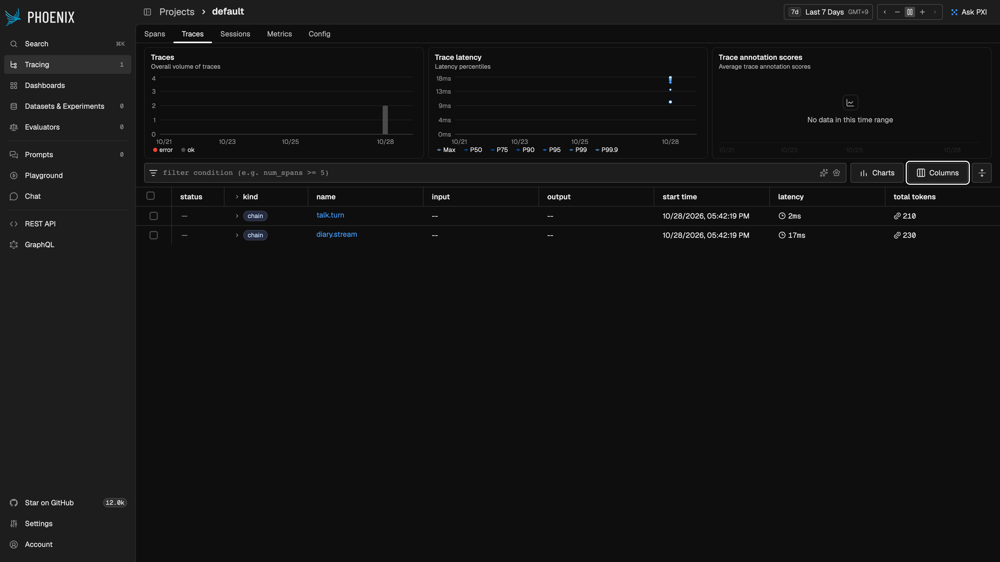
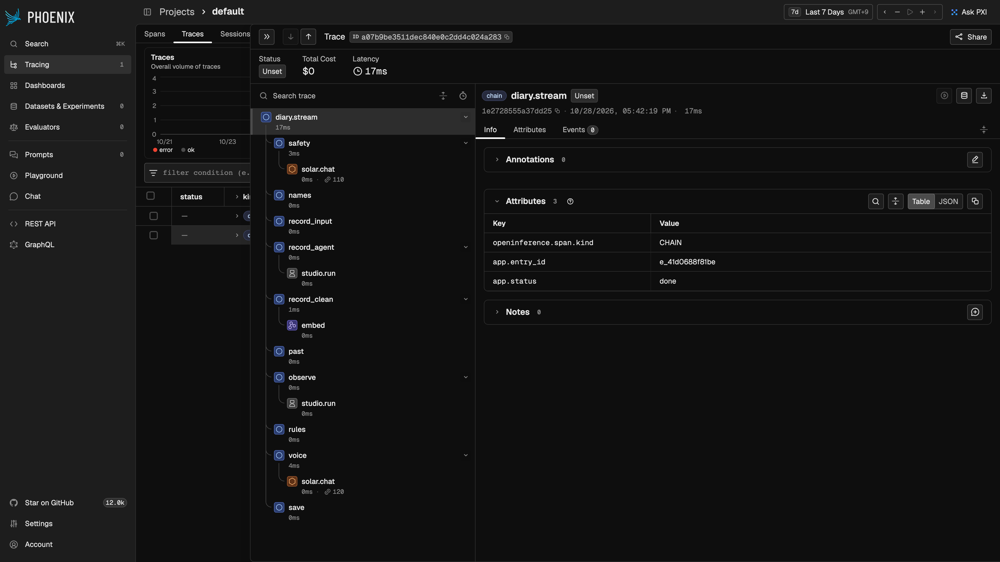
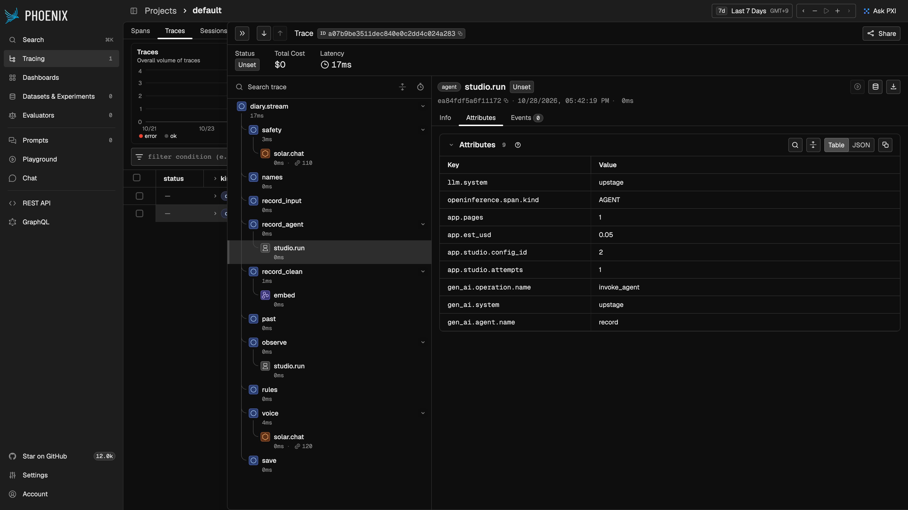
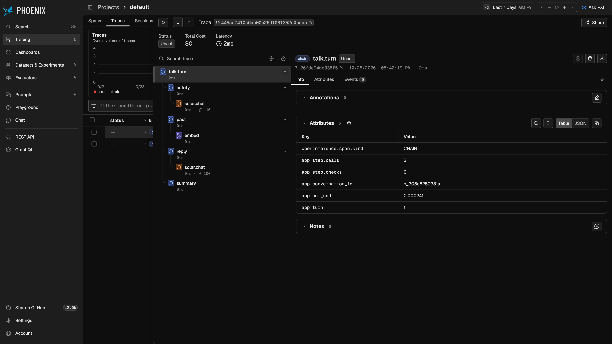

# 요청 추적(Trace) — OpenTelemetry + 로컬 Phoenix

2026-10-28. LLMOps 과제 「Trace 스크린샷 — 요청 1건이 어떤 도구 · 단계를 거쳤는지 추적」용.
코드는 OpenTelemetry(표준)로 span 을 만들고, 화면은 로컬에서 띄운 Arize Phoenix 로 본다. 운영 배포에는 켜지 않는다.

## 1. 무엇을 추적하나

요청 하나 = trace 하나 = span 나무 하나. 맨 위 span 아래에 그래프 단계가 차례로, 단계 아래에 그 단계가 부른 외부 호출이 붙는다.

```
diary.stream            POST /diary/stream (이어 하기는 diary.resume, 스트림 없는 POST /diary 는 diary.write)
├─ safety               └─ solar.chat (위기 2차 판정)
├─ names
├─ record_input
├─ record_agent         └─ studio.run (기록 Agent)
├─ record_clean         └─ embed (생각 벡터)
├─ past
├─ observe              └─ studio.run (관측 Agent)
├─ rules
├─ voice                └─ solar.chat × n (한마디 · 검사)
└─ save

talk.turn               POST /talk/{id}/turn/stream
├─ safety  └─ solar.chat
├─ past    └─ embed (지난 기록 찾기)
├─ reply   └─ solar.chat × n
└─ summary

talk.finish             POST /talk/{id}/finish/stream
├─ draft   └─ solar.chat (대화 → 일기 초안)
└─ diary.stream         (위 일기 나무, 요약 확인 전이라 save 앞에서 멈춤)
```

사진 읽기(`ocr`), 말로 쓰기(`stt`), 읽어 주기(`tts`), 운영 화면의 피드백 정리(`solar.chat`)는 각자 한 span 짜리 trace 가 된다.

| 어디서 | 파일 |
|---|---|
| 맨 위 span | `app/api/diary.py` `_start` · `app/api/chat.py` `_turn_queue` · `finish` |
| 단계 span | `app/agents/graph.py` `node()` · `app/agents/chat_graph.py` `node()` · `make_draft` |
| 외부 호출 span | `app/core/llm.py` (solar.chat · embed) · `app/agents/studio.py` (studio.run) · `app/service/ocr.py` · `app/service/stt.py` |
| 켜기 · 거르기 | `app/core/trace.py` |

단계 span 의 숫자는 `runs` 행(시간 · 호출 수 · 추정 비용 · 오류 코드)과 같은 곳에서 같은 값을 쓴다.
그래프는 백그라운드 스레드에서 돌기 때문에 스레드를 띄울 때 지금 문맥(`contextvars.copy_context()`)을 넘겨 나무가 끊기지 않게 했다.

## 2. 개인정보 규칙: 숫자 · 이름표만

일기 원문 · 인용 · 사람 이름 · 프롬프트 · 모델 답은 span 에 절대 넣지 않는다. 코드가 막는다(`app/core/trace.py`).

- **허용 목록**: `ALLOWED` 에 있는 이름만 내보낸다. 없는 이름(`text` · `prompt` · `output` · `user_id` …)은 조용히 버린다.
- **값 모양**: 숫자 · 참거짓, 그리고 영문 · 숫자 · `_.:/-` 로만 된 64자 이하 글자(id · 코드 · 모델 이름)만. 한글이나 빈칸이 든 글은 허용한 이름이어도 버린다.
- **예외**: 메시지 · 스택(exception 사건)은 남기지 않는다. 예외 종류 이름(`error.type`)과 오류 코드(`app.error_code`)만.
- **사용자**: 사용자 id 는 넣지 않는다. 기록 id(`e_…`) · 대화 id(`c_…`)는 무작위 값이라 넣는다.
- 자동 계측 패키지(요청 본문을 담을 수 있음)는 쓰지 않는다. 의존성은 `opentelemetry-sdk` · `opentelemetry-exporter-otlp-proto-http` 둘.

| 내보내는 속성 | 뜻 |
|---|---|
| `openinference.span.kind` | Phoenix 그림 구분(CHAIN · AGENT · LLM · EMBEDDING · TOOL) |
| `gen_ai.system` · `gen_ai.operation.name` · `gen_ai.agent.name` · `gen_ai.request.model` | 어느 서비스 · 무슨 호출 · 기록/관측 Agent · 모델 이름 (OpenTelemetry GenAI 규약) |
| `gen_ai.usage.input_tokens` · `gen_ai.usage.output_tokens` | 토큰 수 |
| `error.type` · `http.response.status_code` · `app.error_code` | 예외 종류 · HTTP 상태 · runs 와 같은 오류 코드 |
| `app.entry_id` · `app.conversation_id` · `app.turn` · `app.status` | 기록 id · 대화 id · 몇째 턴 · 결과 상태(done · confirm · failed) |
| `app.step.calls` · `app.step.checks` · `app.step.skipped` · `app.est_usd` | 단계의 외부 호출 수 · 검사 문제 개수 · 이어 하기에서 건너뜀 · 추정 비용(달러) |
| `app.studio.config_id` · `app.studio.attempts` · `app.pages` · `app.embed.texts` | Studio 설정 번호 · 시도 수 · 쪽 수 · 벡터로 만든 글 수 |
| `app.audio.seconds` · `app.audio.bytes` · `app.audio.format` · `app.tts.chars` | 녹음 길이 · 크기 · 형식 · 읽어 준 글자 수 |

Phoenix 는 받은 `gen_ai.*` 를 자기 이름(`llm.model_name` · `llm.token_count.*` · `embedding.model_name` · `llm.system`)으로 한 벌 더 보여 준다. 우리가 보낸 것은 위 표뿐이다.

시험(`tests/test_trace.py`): 글 같은 속성 · 예외 메시지가 버려지는지, 가짜 일기 한 편 · 대화 한 턴 · 대화 마치기 · 이어 하기가 기대한 나무가 되는지, 모든 span 에 일기 낱말 · 사람 이름이 없는지(메모리 exporter).

## 3. 켜는 법

`OTEL_EXPORTER_OTLP_ENDPOINT` 가 있을 때만 켜진다. 없으면 `trace.span` 은 아무것도 하지 않고 지나간다(지금 운영 그대로).

```bash
# 1) Phoenix (Docker 없이, 처음엔 받는 데 1~2분)
uvx arize-phoenix serve                                   # 화면 http://localhost:6006 , OTLP http://localhost:6006/v1/traces

# 2-a) 유료 호출 0, Docker 없이: 메모리 저장소 + 가짜 Upstage 로 진짜 API 길을 한 번씩 (가상 인물 하늘의 일기 1편 + 대화 1턴)
uv run --frozen python scripts/trace_demo.py

# 2-b) 로컬 전체(로컬 Supabase · Chroma, Upstage 만 가짜): scripts/dev_up.sh 뒤
OTEL_EXPORTER_OTLP_ENDPOINT=http://localhost:6006 uv run --frozen python scripts/dev_fake_upstage.py 8013

# 2-c) 진짜 Upstage(유료): .env.local 에 OTEL_EXPORTER_OTLP_ENDPOINT=http://localhost:6006 을 넣고 평소처럼 백엔드를 띄운다
```

`OTEL_SERVICE_NAME`(기본 `my-universe`)으로 서비스 이름을 바꿀 수 있다. 보내기는 묶어서(BatchSpanProcessor) 하고, 프로세스가 끝날 때 남은 것을 보낸다.

## 4. 과제의 3계층 평가와 대응

| 계층 | 이 추적에서 보는 곳 | 예 |
|---|---|---|
| Trajectory(경로) | 맨 위 span 아래 단계 span 의 **순서** | `safety → names → record_input → record_agent → record_clean → past → observe → rules → voice → save`. 대화 초안은 `voice` 에서 멈추고, 이어 하기는 끝난 단계가 `app.step.skipped=true` |
| Span(단계) | 단계 · 외부 호출 span 의 **속성** | 단계마다 시간 · `app.step.calls` · `app.est_usd` · `app.error_code`, Studio 는 `gen_ai.agent.name` · `app.studio.attempts` · `app.pages`, Solar 는 모델 · 토큰 |
| Final(결과) | 맨 위 span 의 **결과 속성** | `app.status`(done · confirm · failed) · `app.error_code`. 결과 내용(생각 · 한마디)은 span 에 없고, 그 품질은 골든셋(`eval/run.py`)이 본다 |

시험 `tests/test_trace.py::test_diary_stream_span_tree` 가 Trajectory(순서)와 Span(외부 호출이 어느 단계 아래 붙는지 · 속성)을 코드로 확인한다.

## 5. 스크린샷 (2026-10-28, `scripts/trace_demo.py` → 로컬 Phoenix 20.26.1)

가짜 Upstage 라 외부 호출이 0ms 에 가깝다(실제로는 `studio.run` 이 대부분을 차지). 나무 모양과 속성을 보려는 그림이다.

1. trace 목록: 일기 1편(`diary.stream`) · 대화 1턴(`talk.turn`). input · output 칸이 `--` (원문을 보내지 않음), 걸린 시간 · 토큰
   
2. 일기 한 편의 span 나무(단계 순서 · 단계별 시간 · 외부 호출)
   
3. 기록 Agent `studio.run` 의 속성: 숫자 · 이름표만
   
4. 대화 한 턴의 span 나무와 맨 위 span 속성(턴 · 호출 수 · 비용)
   

## 6. 운영(Vercel)에서는

지금은 켜지 않는다(환경변수를 넣지 않음). 이유:

- Vercel 함수는 응답 뒤 멈출 수 있어 묶어 보내는 span 이 사라지기 쉽다. 켜려면 요청 끝에 `force_flush` 를 부르거나 바로 보내기(SimpleSpanProcessor)로 바꿔야 하고, 그만큼 응답이 늦어진다.
- 내보낼 곳이 외부 서비스(Phoenix Cloud · Langfuse 등)가 된다. 숫자 · 이름표뿐이어도 처리 위탁 · 개인정보처리방침에 한 줄이 늘어난다.
- 운영 지표는 이미 `runs` 표 · `/ops` 화면 · 원문 없는 로그가 같은 숫자를 갖고 있다.

필요해지면(예: 느린 요청 원인 찾기) 표본 몇 %만 · 보관 기간을 짧게 · 우리 계정의 수집기로 먼저 시험해 보길 권한다.
